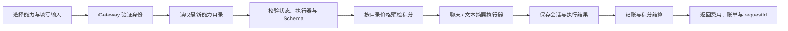

# AICapabilityHub Pro

**AI 能力开放平台 Pro · 面向开发者的 AI 能力执行与计量平台**

按能力执行，让参数、费用与调用结果可追踪。

**开发入口：** [AICapabilityHub Pro 开发指南](AICapabilityHubPro-开发指南.md) · [文档索引](docs/README.md) · [跨成员共享契约](docs/api-contract/pro-shared.md)。原指南与旧阶段分工已归档，不再指导当前开发。

AICapabilityHub Pro 面向 AI 能力的接入、调试与调用核验。开发者选择能力后，平台读取该能力的最新状态、输入 Schema 和积分单价，通过受控的聊天或文本摘要执行器完成请求，并将能力 ID、实际费用、账单和积分流水串联到同一个 requestId。

本项目由前三周的 AICapabilityHub 基础版本演进而来。Pro 的重点是**能力目录驱动的执行闭环**：把“选择什么能力、提交哪些参数、消耗多少积分、在哪里核对结果”放到同一条链路中。三人业务代码已集成到 main；当前进行非部署验收收尾，正式发布与人工签字分别记录，不由代码合并代替。

## Pro 带来的变化

| 维度 | AICapabilityHub 基础版本 | AICapabilityHub Pro |
|---|---|---|
| 调用对象 | 通用聊天入口，与能力目录相对独立 | 按 capability_id 获取目录快照，再选择受控执行器 |
| 参数输入 | 主要使用聊天消息 | 调试台根据能力 Schema 展示输入，服务端再次校验 |
| 执行能力 | 对话与会话历史 | 聊天、文本摘要分别映射输入；未知执行器明确拒绝 |
| 计费依据 | 固定 POINTS_COST，未绑定具体能力 | 使用目录登记价预检余额并计量，关联真实能力 ID |
| 调用核验 | 日志、积分与用量信息分别查看 | 结果展示实际费用、账单编号、状态、耗时及 requestId |
| 身份治理 | JWT 与基本身份透传 | 清理伪造身份/角色头，精确配置兑换入口、限流和缓存策略 |
| 交付验证 | 各模块基础测试 | 隔离数据库、真实服务 E2E、桌面与手机浏览器验收 |
| 项目资源 | 原课程项目工作区与资源 | 独立仓库、容器命名和数据卷，可与原版本并行运行 |

## 当前功能与交付边界

| 模块 | 当前可用内容 | 状态 |
|---|---|---|
| 能力调试台 | 能力选择、Schema 表单、聊天/摘要输入、价格预览、历史会话 | 已实现 |
| 能力执行链 | 最新目录查询、上架状态/allowlist/Schema 校验、目录价预检、计量收据核验 | 已实现 |
| 计量与追踪 | capability_id、费用、账单、积分流水与 requestId 对齐；模型降级不收费 | 已实现并通过真实服务联调 |
| Gateway 治理 | 签名身份与角色转发、伪造头清理、内部路径隔离、兑换入口限流 | 已实现 |
| 目录内部接口 | 真实内部详情、最新状态/Schema/单价与失败关闭 | 已通过 strict internal 真实链 |
| 市场体验入口 | 市场卡片携带所选能力 ID 进入调试台，提供参数详情与执行器状态 | 已实现，随本轮前端提交验收 |
| 角色与权限 | user 实时授权，capability 管理与 billing 全局统计保护 | 已实现并联调，旧 JWT 不绕过撤权 |
| API Key 兑换 | 一次性 Secret、摘要校验、状态/期限与受限 JWT；Gateway 精确 POST/限流/no-store | 已实现并通过真实兑换链 |

2026-10-20，PR #4（黄禹菲：user/billing/Settings）与 PR #5（夏思凯：capability/市场/Console，含安全迁移修复）已合入 main `651275b`，主分支 CI `39420321602` 为 9/9。收尾新增的真实 Settings/管理员 Console 浏览器验收、演示与候选版本约定见[非部署收尾记录](docs/验收收尾记录-2026-10-20.md)。完整正式版尚未发布。

视觉理解、语音转写、知识检索等不属于本期可执行能力。平台只调用代码中明确允许的执行器，不执行用户传入的目标 URL，也不把目录中的 service/path 当作任意代理地址。

## 执行链路



每次执行重新核对能力，价格由目录提供。下架、未知能力、未实现执行器、错误输入、禁用用户和余额不足会在模型前被拒绝。模型超时或坏响应按原契约降级，保留调用记录，实际费用为 0。

`USE_MOCK=true` 时执行本地模拟并明确返回 `mock=true`；摘要模拟结果来自输入文本的提取。真实模型模式使用服务端配置的兼容接口。模拟执行、HTTP 模型替身测试和真实供应商验收分别记录。

真实模型只需在 `services/ai-chat-service/.env` 配置四项，不必改代码：

| 配置项 | 说明 |
|---|---|
| `USE_MOCK` | `false` 走真实供应商，`true` 走本地模拟 |
| `MODEL_BASE_URL` | OpenAI 兼容根地址，如 `https://api.deepseek.com/v1` |
| `MODEL_API_KEY` | 供应商密钥，仅存本地 `.env`，不提交仓库 |
| `MODEL_NAME` | 服务端默认模型名，如 `deepseek-flash`；请求显式传 `model` 时以请求为准 |

模型名必须与供应商目录一致，否则会被对方拒绝并降级为不计费的兜底回复（回执中 `degraded=true`、`error_code=5002`）。

## 架构与技术栈

| 层级 | 组件 | 职责 |
|---|---|---|
| 工作台 | React 19.2、TypeScript、Vite、Tailwind CSS 4 | 能力选择、输入、结果与调用核验 |
| 统一入口 | Spring Cloud Gateway、JWT、Sentinel | 路由、可信身份、限流、内部接口隔离 |
| 业务服务 | Python 3.12、FastAPI、SQLAlchemy、JSON Schema | 用户积分、能力目录、调用执行与计量 |
| 中间件 | MySQL 8.4、Nacos 2.5.1、Sentinel Dashboard 1.8.10 | 数据存储、服务发现、配置与治理 |
| 静态入口 | Nginx 1.27-alpine | 托管前端构建并代理 /api 至 Gateway |
| 验证 | JUnit、pytest、Playwright、GitHub Actions | 单测、隔离数据库、服务与浏览器验收 |

Gateway 使用 JDK 21、Maven 3.9.x、Spring Boot 3.5 / Spring Cloud 2025；前端工具链使用 Node 24、pnpm 11。

四个服务分别拥有 `user_db`、`capability_db`、`billing_db`、`ai_chat_db`。服务间按契约调用，不跨库查询；浏览器统一通过 `/api/**` 访问 Gateway。

## 快速启动

以下为 Windows PowerShell 的 Pro 并行开发配置。先安装上述工具链并启动 Docker Desktop。若正在运行旧组件，先确认其所属项目；启动工具不会结束占用端口的进程。

### 1. 获取代码并初始化

```powershell
git clone https://github.com/magicapple123/AICapabilityHubPro.git
Set-Location AICapabilityHubPro
git switch main

python scripts/init_dev.py --install
.\scripts\Test-ProEnvironment.ps1
```

已经在 `D:\AICapabilityHubPro` 工作的机器直接从初始化命令开始。初始化只创建缺失配置，保留现有 `.env`，生成一致的 JWT/数据库配置；真实配置不纳入 Git。

### 2. 启动独立中间件

```powershell
python scripts/start_pro_local.py middleware
```

| 组件 | Pro 主机端口 | 资源说明 |
|---|---|---|
| MySQL | 3307 | `aihub-pro-mysql`，数据卷 `aihub-pro-mysql-data` |
| Nacos | 8849 / 9849 | `aihub-pro-nacos` |
| Sentinel Dashboard | 8859 | `aihub-pro-sentinel` |
| Gateway | 8080 | 本机 JVM |
| user / capability / billing / ai-chat | 8081 / 8082 / 8083 / 8090 | 本机独立 Python 环境 |
| Web | 5173 | Vite，绑定 localhost |

Pro Compose project 为 `aicapabilityhubpro`，不挂载原项目的数据卷。首次新建卷会执行初始化脚本；已有数据库升级不能靠清空卷或重复导入 seed 替代。详见 [双项目并行联调](docs/双项目并行联调.md)。

### 3. 分别启动六个组件

每条命令各占一个终端，工作目录均为项目根目录：

```powershell
python scripts/start_pro_local.py user-service
python scripts/start_pro_local.py capability-service
python scripts/start_pro_local.py billing-service
python scripts/start_leader_dev.py ai-chat-service --catalog-mode internal
python scripts/start_leader_dev.py gateway
python scripts/start_leader_dev.py web
```

推荐默认 `internal` 严格模式，`GET /internal/capability/{id}` 已交付并通过完整真实链。`market` 仅为显式兼容模式，不自动回退；接口缺失或异常仍失败关闭。已有数据库需先由负责人备份、核验增量迁移，不能直接重导 seed；本轮收尾未迁移或重启现有环境。

### 4. 登录与体验

访问 `http://localhost:5173`，本地公开演示账号为 `demo / demo123456`。默认使用真实账号登录；模型模拟与占位登录是两个独立开关。

- 聊天：`/chat?capability_id=1`，演示目录价格 5 积分。
- 文本摘要：`/chat?capability_id=2`，演示目录价格 3 积分。
- 低余额场景：本地账号 `demopoor / demo123456`。

以执行时的目录单价为准。结果可查看实际费用、账单编号、状态、耗时和 requestId，并到调用记录/积分页面核对。已有组件不要重复启动；前台进程用 Ctrl+C 结束。

完整演示顺序见 [组长功能演示与交接](docs/组长功能演示与交接.md)。Nginx 部署、默认端口配置和故障排查见 [上手与联调](docs/上手与联调.md)及 [Web 说明](web/README.md)。

## 验证与交付证据

```powershell
# 公共检查与只读网关烟测
python scripts/contract_lint.py
python -m pytest tests/tooling -q
python scripts/smoke_check.py

# Gateway 与 Web
mvn -q -f gateway/pom.xml package
pnpm --dir web lint
pnpm --dir web build
pnpm --dir web exec node --experimental-strip-types --test tests/chat-schema.test.ts

# 独立环境的真实服务和浏览器验收
pnpm --dir web exec playwright install chromium --no-remove
python scripts/run_leader_e2e.py --catalog-mode market --browser
python scripts/run_leader_e2e.py --catalog-mode internal --browser
```

数据库 pytest 含测试行清理逻辑，应连接专用验收实例，不能直接使用开发数据库。CI 为四个服务提供隔离 MySQL，并用 `scripts/check_test_report.py` 拒绝空报告、跳过、失败和错误。E2E 单独创建数据库/进程/端口，模型端使用本地 HTTP 测试替身，测试后保留日志和数据卷以供复核。

2026-10-20 的三人集成 main 基线 `651275b`，主分支 CI `39420321602` 已验证（本次扩展浏览器结果另见收尾记录）：

| 范围 | 结果 |
|---|---|
| 四个服务数据库测试 | user 95、billing 87、capability 131、AI 56；共 369，零 skipped / failure / error |
| Gateway | 35 项通过 |
| 公共工具 / 前端输入 | 该基线 13 / 8 项通过；本轮新增 22 项隔离账号测试 |
| 真实服务 E2E | market 22 / internal 21 项通过，内部契约标记均为 true |
| 桌面 / 手机浏览器 | 该基线每模式 9 项；Settings/管理员扩展见收尾记录 |
| 该提交 GitHub Actions | 9 / 9 检查通过 |

本轮扩展源码882bb5b的CI39446101405为9/9：每种目录模式均完成32项真实浏览器检查（Chat9、Settings11、Console12），公共工具35项。它与上表历史业务基线分别留档；后续修改仍以自己的CI为准。工作流、报告和限制详见 [质量门禁](docs/质量门禁说明.md)、[业务完成记录](docs/组长业务完成记录-2026-10-19.md)及 [验收矩阵](docs/验收用例.md)。

10/20全站改版见[历史前端记录](docs/前端改版与验收-2026-10-20.md)；其中模拟写响应的检查不代替真实管理员/Key流程，后续真实覆盖与提交证据见[收尾记录](docs/验收收尾记录-2026-10-20.md)。

## 项目目录

```text
AICapabilityHubPro/
├─ gateway/                       # 统一入口与可信身份
├─ services/
│  ├─ user-service/               # 账号、Key、积分
│  ├─ capability-service/         # 目录、Schema、价格与状态
│  ├─ billing-service/            # 计量、记账与用量
│  └─ ai-chat-service/            # 受控聊天/摘要执行
├─ web/src/features/chat/         # 能力调试与结果核验
├─ platform-py/service-template/  # Python 服务基础模板
├─ deploy/                       # 独立中间件与 Nginx
├─ scripts/                      # 初始化、启动、质量与 E2E 工具
└─ docs/                         # 契约、计划、验收与交接
```

## 协作与版本说明

黄岑果负责 Gateway、AI 执行链、调试台与集成；黄禹菲负责用户/计量、角色、Key 和设置；夏思凯负责目录、运营授权、Schema 与市场入口。当前边界和待办以 [实施看板](docs/升级实施看板.md) 为准。

当前从最新 origin/main 开发并提交目标 main 的 PR；develop 尚未同步这批 Pro 升级，主动同步确认前不作为成员起点。仓库所有者于2026-10-20暂时关闭 main 保护，并明确授权验证通过后合并；本次非部署收尾及候选 Tag 也已单独确认。未代替组员人工 Review，未擅改保护设置或强推。原仓库、旧分支与原始数据保留。

项目统一名称、简介、About 和对外表达见 [项目定位与描述规范](docs/项目定位与描述规范.md)。详细协作流程见 [CONTRIBUTING](CONTRIBUTING.md)，接口以 [Pro 执行契约](docs/api-contract/ai-chat-service.md) 和各服务契约为准。

## 已知边界

- 三人业务与严格内部目录已集成；现有环境部署/迁移、真实供应商验收和三人正式签字不以隔离自动化通过替代。
- 会话本地事务与远端记账不构成分布式原子事务；远端成功、本地最终提交失败时按 requestId 对账，不能盲目重试模型。
- Pro 目前支持受控聊天与文本摘要，不包含任意插件执行、视觉/语音执行、SSE、真实支付或外部供应商可用性保证。
- 组长业务无需新增数据库列；其他成员的数据结构升级须提供保留旧数据的增量迁移。
