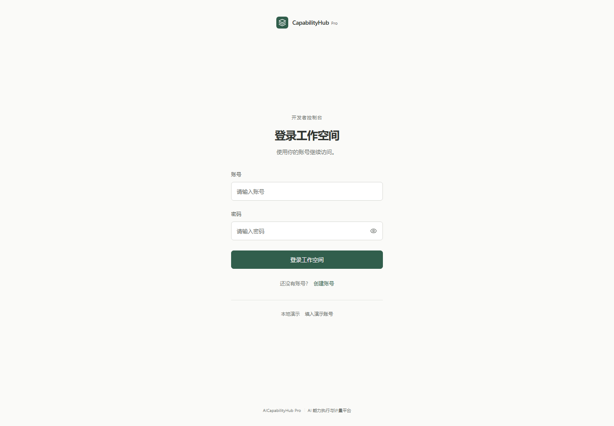
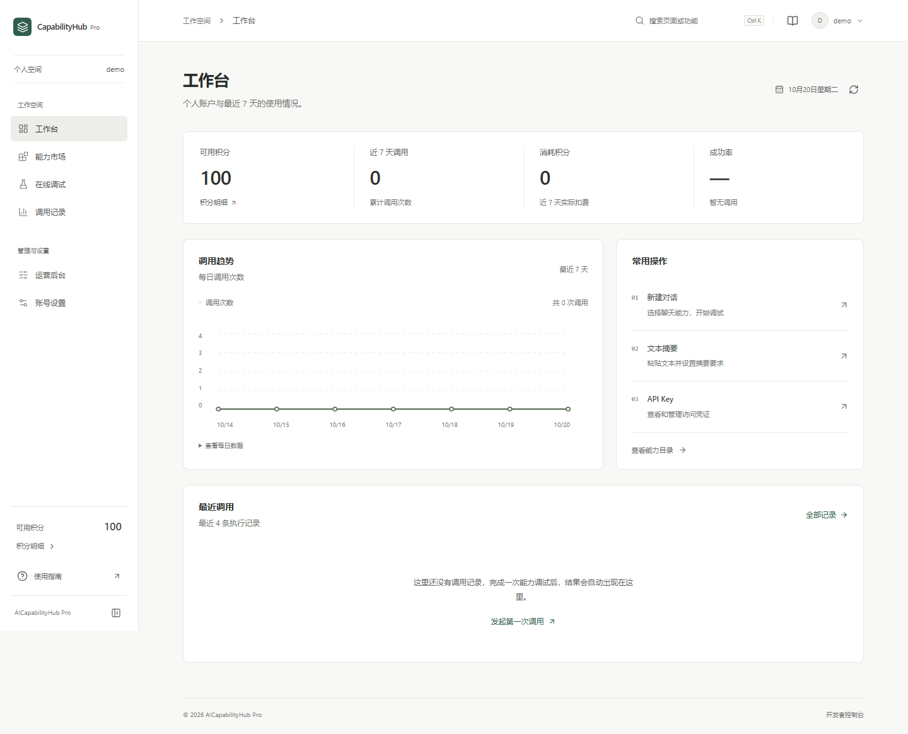
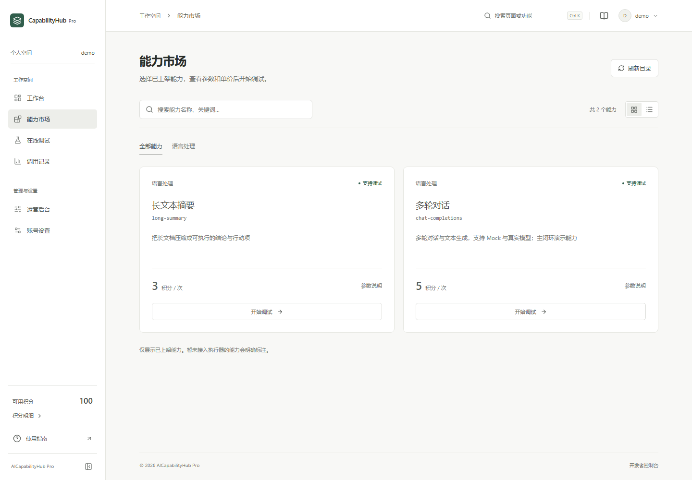
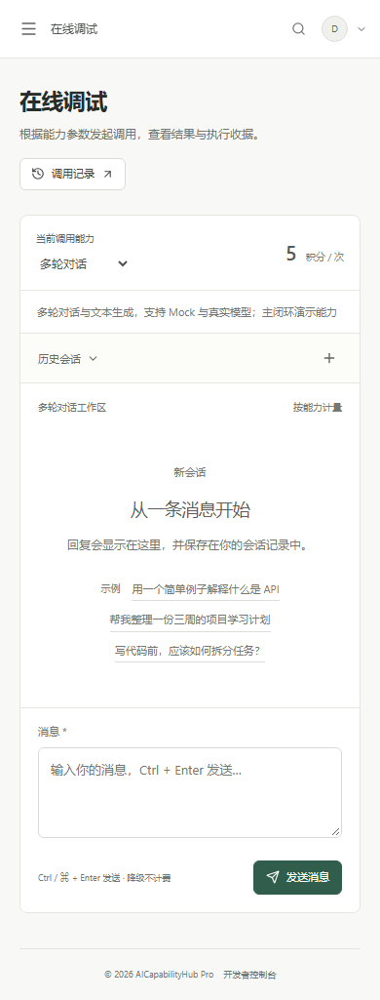

# 前端改版与验收记录（2026-10-20）

本次交付包含前端视觉、布局和交互改版。登录与注册采用单列居中布局；工作台移除宣传横幅，按个人用量、常用操作和最近调用组织内容。主内容最大宽度为 1160px，在工作区内居中，顶栏与内容使用相同对齐边界。

前端源码已应用到正式的 web 目录。默认入口仍为 http://localhost:5173，使用原有环境配置；此前 5174/5175 独立预览是本机评审资源，不是项目启动要求。

## 页面变化

| 页面 | 本次完成 |
|---|---|
| 登录 / 注册 | 品牌、标题、表单和页脚共享中轴；密码显隐、Caps Lock 提示、重复提交保护和登录后回到原目标页面 |
| 工作台 | 真实积分余额、近 7 天调用/消耗和成功率；每日趋势、常用入口与最近记录 |
| 能力市场 | 分类、中文搜索、防抖、卡片/列表视图、参数详情；携带选中 capability_id 进入调试；无兼容执行器时禁用调试 |
| 在线调试 | 会话搜索、示例输入、参数折叠、快捷发送、复制与代码块；执行收据；未提交输入与执行中离开提醒 |
| 调用记录 | 7/30/90 天区间、状态筛选、分页、详情弹窗、完整 requestId 复制；当前页 CSV 导出并处理公式单元格 |
| 账号设置 | 个人资料、积分、API Key 页签；昵称修改与撤销；密钥创建防重复、一次展示、关闭和禁用确认 |
| 运营后台 | 分类、能力和平台用量分区；独立编辑表单与上下架/删除确认，继续使用原有业务接口 |
| 全站 | 中性色与少量绿色强调；减少宣传文案、彩色卡片与装饰图标；移动端抽屉导航、键盘功能搜索、错误重试和 404 恢复 |

本次为用户授权的全站前端调整。两位成员仍负责对应服务的内部目录、实时管理员授权、Key exchange/TTL、角色和单价持久化等业务升级；界面整理不代表这些服务端任务已完成。

## 页面截图

### 登录入口

### 工作台

### 能力市场

### 手机调试台

## 当前提交的本地验证

| 检查 | 实际结果 |
|---|---|
| TypeScript 应用与构建配置 | 通过 |
| ESLint | 通过，0 error、0 warning |
| 生产构建 | 通过 |
| 现有输入逻辑回归 | 6/6 通过 |
| 目录显示编码兼容 | 10 个用例通过 |
| 前端浏览器检查 | 95/95 通过 |
| Gateway 冒烟 | 8/8 通过 |
| 独立环境真实服务 E2E | 22/22 通过 |
| 独立环境真实浏览器执行 | 7/7 通过 |
| 源文件体积 | 70 个源文件全部不超过 300 行，入口文件不超过 100 行 |
| 接口契约格式检查 | 通过 |

前端浏览器检查覆盖 2560、1920、1440、768、390 和 320px；每个尺寸包含 10 个业务页面。登录页在六个尺寸下的水平中心误差为 0px；桌面工作区内容同样测得 0px，未发现整页横向溢出。

95 项检查使用真实登录和读取接口；执行与密钥创建/禁用等写场景使用浏览器拦截响应，并对未拦截的业务写请求设防。登录状态只保存在测试进程内存中，未导出包含 JWT 的浏览器状态文件。

22 项 E2E 与 7 项浏览器执行运行在独立 MySQL、真实四服务和 Gateway 上，实际验证聊天 5 积分、摘要 3 积分与 requestId 收据；外部模型使用本地 HTTP 测试替身。默认严格 internal 模式的缺失依赖拒绝检查通过，完整内部目录服务端仍待交接。

本机证据目录：

- artifacts/frontend-upload-20261020-075545-435a0/browser-20261020-075903-53685
- artifacts/leader-e2e/20261020-075940-46e5f1

可公开的检查摘要见 [验收证据](evidence/frontend-2026-10-20.json)。本机日志、备份、数据库和环境文件不提交 Git。当前提交的 GitHub CI 状态以 PR 为准。

## 复现主要检查

在 web 目录执行 pnpm lint、pnpm build 与 node --experimental-strip-types --test tests/chat-schema.test.ts。真实链从项目根目录执行 python scripts/run_leader_e2e.py --catalog-mode market --browser，需预先打包 Gateway、安装依赖并启动 Docker 和 Nacos；测试资源独立创建并保留，不清理开发库。

生产构建的入口资源约为 776.55 kB（gzip 255.05 kB），仍有单包超过 500 kB 的提示。业务页面已按路由加载；此次未提高阈值或隐藏警告。

## 兼容和恢复

目录显示适配针对本机部分 UTF-8 被误按 Windows-1252 解码的旧演示文本，仅在严格还原成功且包含中文时转换。正常中文、英文和表情保留原样；不写数据库，也不把显示兼容当成历史数据迁移。

原有浏览器测试改用当前字段标签和执行收据定位，保留原计费、身份、不可执行能力与 requestId 断言，没有删除断言或跳过用例。

应用前 25 个已有前端文件已备份到 artifacts/frontend-upload-20261020-075545-435a0/source-backup-20261020-075715，另有本轮文档和测试的修改前副本。新增文件通过独占方式创建；已有文件核验哈希后替换。没有删除文件、清空数据或修改分支保护规则。
