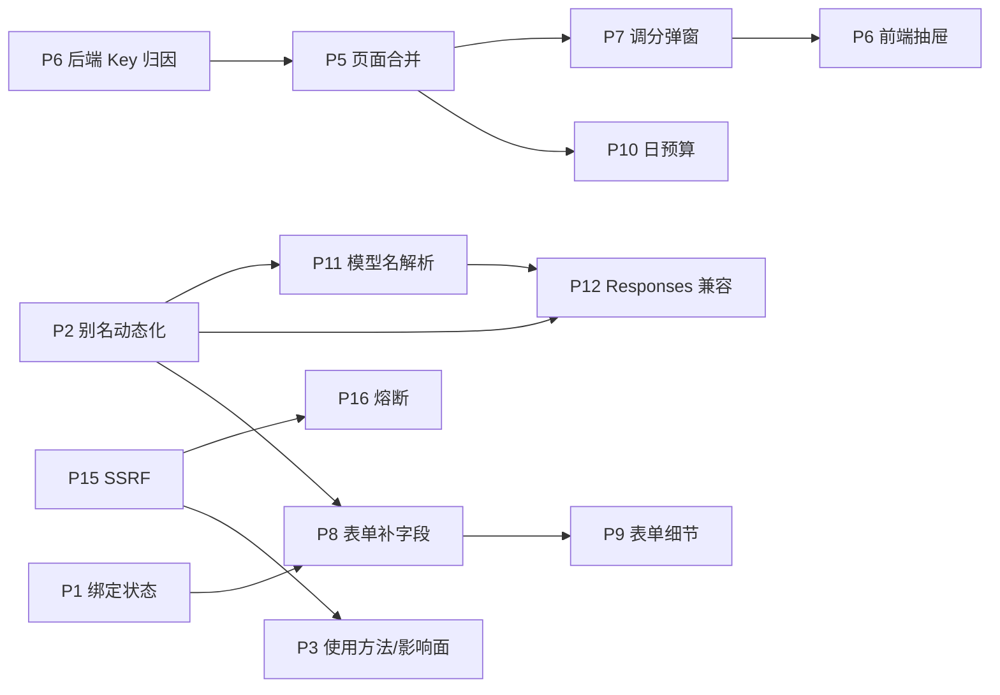

# AICapabilityHub Pro · 排查问题清单与实施编排（2026-11-03）

> **文档性质**：需求 + 方案 + 实施编排。由一轮完整代码排查产出，共 **16 条**（P1–P16），
> 每条均经代码核验，包含现象、证据位置、根因、方案、验收标准与风险。
> **排查阶段未修改任何产品代码**；实施由接到本文档的新对话完成。
> **阅读顺序**：先读文末「附录 A 执行协议」与「附录 B 实施编排」→ 按波次逐条实施 → 每条照「附录 C」验证并截图 → 最后按「附录 D」出报告。
> **基线**：2026-11-03 11:40 的工作区（含 94 个文件未提交改动）。行号会随提交漂移，**实施前必须重读代码确认**，
> 文档与代码冲突时以代码为准，并把差异记进实施日志。

## 索引

| 编号 | 标题 | 来源问题 | 优先级 | 状态 |
|---|---|---|---|---|
| P1 | 供应商-能力绑定缺少状态校验，2008 错误码语义混淆 | Q1 新增供应商后团队成员如何使用 | P0 | ✅ 完成（`p1_provider_state.mjs` PASS） |
| P2 | OpenAI 兼容层模型别名静态化，新能力无法免重启接入 | Q1 | P0 | ✅ 完成（别名 48ms 可见，c=10 qps 34.3） |
| P3 | 成员侧凭证用法与供应商影响面提示缺失（含「使用方法」抽屉） | Q1 / Q4 | P1 | ✅ 完成（抽屉三页签 + 停用影响面） |
| P4 | 操作审计表格列宽失控，横向滚动条 | Q2 审计页排版 | P2 | ✅ 完成（1440/1280/1024/375 零横溢） |
| P5 | 「平台用量」与「用户管理」两个页签信息割裂，建议合并为「用户与用量」 | Q3 | P1 | ✅ 完成（方案 A：完整合并） |
| P6 | 调用记录缺少 API Key 维度，管理员无法按 Key 归因；Key 生命周期无审计 | Q4 | P1 | ✅ 完成（`p6_key_attribution.mjs` PASS） |
| P7 | 调分使用浏览器原生 prompt，无预览/校验/原因引导 | Q5 | P1 | ✅ 完成（原生弹窗清零） |
| P8 | 能力登记表单缺少执行器/供应商/计价字段；"可执行"判断仍用旧 code | Q6 | P0 | ✅ 完成（含市场出参补 `executor`） |
| P9 | 能力登记表单的布局与交互细节 | Q6 | P2 | ✅ 完成（720px / 375px 截图） |
| P10 | 日预算只有拦截没有配置入口（C3 半交付） | Q7 团队场景走查 | P1 | ✅ 完成（接口 + 抽屉内联编辑） |
| P11 | 绑定供应商后，文本能力仍发送全局 MODEL_NAME，供应商默认模型失效 | Q8 多供应商路由 | P0 | 🟡 同厂商双模型 4/4 通过；跨厂商缺 Qwen 凭证未验 |
| P12 | 外部 Agent（Codex 等 Responses 客户端）接入被 4001 阻断，协议翻译不完整 | Q7 追问 Codex 场景 | P0 | ✅ 协议层完成（`p12_responses.mjs` PASS）；Codex CLI 端到端未做 |
| P13 | 容器化"一键部署"缺三块：关键文件未入库、无 Linux 引导、lock 安装失效 | Q10 Docker 交付 | P1 | ✅ 完成（9 容器 healthy） |
| P14 | 账号生命周期边界不完整：禁用后只读接口仍可用、令牌不可吊销、登录无防爆破 | Q11 后端审计 | P1 | ✅ 完成（`p14_lifecycle.mjs` 26 项 PASS） |
| P15 | SSRF 校验后仍按域名建连（未钉 IP），且注释与实现不符 | Q11 后端审计 | P2 | ✅ 完成（钉扎 7 例；文生图残余窗口已记录） |
| P16 | 上游无熔断、无整体超时预算，单供应商故障即全量降级 | Q11 后端审计 | P2 | ✅ 完成（13 例 + `/metrics` 暴露状态） |

---

## Q1 · 管理员新增上游供应商后，团队成员如何使用

### 现状链路（讨论结论，作为背景）

1. 供应商只是运行参数（`provider_service.py:53-62` 的 `ProviderRuntime`：alias / protocol / base_url / api_key / model / timeout），**本身不可调用、不进市场、普通成员不可见**（`GET /api/chat/providers` 仅管理员，普通用户 2007）。
2. 管理侧必须补完两步：测试并启用供应商（新建恒为 `draft`，`provider_service.py:97`；启用前必须 `last_test_ok_at` 非空，`:124-127`）→ 把能力绑定到该供应商（`executor` + `provider_alias`，`capability.py:108-109`）并上架、开启市场展示。
3. 成员侧三条通道：平台调试台（登录 JWT + 余额）、平台 API（`POST /api/chat/completions`，Key exchange 换 15 分钟 JWT）、OpenAI 兼容（`POST /v1/chat/completions`，API Key Secret `sk_...` 直连）。
4. 断点集中在"第二步之后的可见性"和"跨服务的状态一致性"，拆为 P1/P2/P3。

---

### P1 · 供应商-能力绑定缺少状态校验，2008 错误码语义混淆

- **优先级**：P0（可导致"上架成功但必然失败"）
- **现象**：管理员可以把能力绑到一个仍处于 `draft`（甚至 `disabled`）的供应商并成功上架；市场可见、卡片正常，但每次调用都失败。成员看到 `2008`，通用文案是「该能力暂未提供可用执行器」，与"执行器不存在"完全同一码同一文案，排查方向被误导到执行器注册表。
- **证据**：
  - 绑定校验 `services/capability-service/app/service/capability_service.py:298-330`（`ensure_provider_binding`）只取 `data["protocol"]`，**没有判断 `status`**；
  - 对端其实返回了状态：`services/ai-chat-service/app/api/v1/internal_provider.py:34-40`（`{alias, protocol, status, default_model}`）；
  - 运行期才检查启用态：`services/ai-chat-service/app/service/provider_service.py:198-199`，失败抛 `BizException(2008, f"供应商 {alias} 不存在或未启用")`；
  - 无执行器的同码抛出点：`services/ai-chat-service/app/service/capability_adapters.py:107-110`（「该能力暂未提供可用执行器」）；
  - OpenAI 兼容层把 2008 一律映射为 `400 invalid_request_error`（`openai_compat.py:45-54`），客户端无法区分"参数错"与"平台没配好"。
- **根因**：跨库不建外键，绑定校验只做了"协议匹配"这半条规则；错误码复用了"无执行器"的 2008，没有为"供应商不可用"单独立码。
- **方案**：
  1. `ensure_provider_binding` 增加状态校验：`status != enabled` → `2001`，文案点名供应商 alias 与当前状态，提示"请先在模型服务中测试并启用"。
  2. 新增错误码 `2009 供应商不可用（不存在/未启用/被停用）`，仅由 `resolve_runtime` 抛出；`2008` 从此只表示"执行器未实现"。
  3. 兼容层错误映射：`2009 → HTTP 503 + type=api_error + code=platform_2009`（区别于 2008 的 400）。
  4. 同步更新四份服务契约、`scripts/contract_lint.py` 的错误码清单、OpenAPI 快照与 E2E 断言。
- **预期效果与验收**：
  - 把能力绑到 `draft` 供应商 → 保存立即返回 `2001`，不落库；
  - 运行期停用供应商后调用 → 返回 `2009`，文案含 alias；`/v1/chat/completions` 返回 HTTP 503；
  - 原有的"无执行器"场景仍返回 `2008`，文案不变（回归）；
  - `bash scripts/gate.sh all` 全绿，测试数量不减少。
- **风险与回归面**：新增错误码会波及契约文档、前端错误提示映射、OpenAI 兼容层的错误表；已有 `2008` 断言需逐条确认语义未被改写。capability 保存路径多一次状态判断，无额外 IO（状态已在同一响应里）。

---

### P2 · OpenAI 兼容层模型别名静态化，新能力无法免重启接入

- **优先级**：P0（新增供应商/能力对第三方客户端"不可见"，是"团队成员接不进来"最直接的坑）
- **现象**：运营在后台新增能力后，成员在 Cherry Studio / Continue 的模型下拉框里看不到它；手动填新名字调用返回 `model_not_found`。必须由运维改 `.env` 的 `OPENAI_COMPAT_MODEL_MAP` 并**重启 ai-chat** 才生效，重启会切断正在进行的 SSE 流。
- **证据**：
  - 默认值写死三个别名且全部指向能力 1：`services/ai-chat-service/app/core/config.py:71`（`"deepseek-flash=1,deepseek-chat=1,chat-completions=1"`）；
  - 解析函数每次调用都重新切分这段字符串：`services/ai-chat-service/app/api/v1/openai_compat.py:64-73`（`_model_map`）；
  - `/v1/models` 只列这份配置：`openai_compat.py:225-240`；
  - 调用时按别名查表，查不到直接 2002：`openai_compat.py:254-256`；
  - `/v1/responses` 复用同一函数：`services/ai-chat-service/app/api/v1/responses.py:240`；
  - 运营后台"模型服务"页当前只读，唯一的写操作是市场展示开关：`web/src/features/console/ModelServicePanel.tsx:27-31`。
- **根因**：模型别名属于"配置"，而能力目录属于"数据"，两者没有打通；别名解析是同步函数，无法直接改成每次请求查目录。
- **方案**：
  1. 能力表新增 `openai_alias`（可空、唯一、`^[a-z][a-z0-9._-]{1,63}$`），随能力一起增删改；迁移需同时更新 `services/capability-service/sql/` 与 `deploy/mysql/init/` 两份口径（本项目已因两份不同步踩过 `t_call_record.images` 缺失导致 4003）。
  2. `_model_map()` 改为读目录：优先走现有 `catalog_cache`（5s TTL），命中失败再回源；复用 `POST /internal/capability-cache/invalidate` 做变更失效，避免每个请求多一次内部调用。
  3. `/v1/models` 只列 `status=online`、`executor=chat`、`openai_alias` 非空的能力（摘要/文生图不出现，避免用户选了再报参数错）。
  4. 兼容层与 `/v1/responses` 共用同一个解析入口，禁止各自维护映射。
  5. 运营侧：能力编辑表单增加「对外模型名」字段 + 唯一性提示；模型服务页支持直接编辑该字段。
  6. 保留 `OPENAI_COMPAT_MODEL_MAP` 作为**兜底/覆盖**（显式配置优先），保证平滑升级。
- **预期效果与验收**：
  - 新建能力并填写别名 → 保存后 ≤5s 内 `GET /v1/models` 可见（受目录缓存 TTL 约束），无需重启；
  - 用该别名调 `/v1/chat/completions` → `platform_cost > 0`，账单与积分流水可对上；
  - 别名冲突 → 保存返回 `2006`（与能力 code 重复同码，或另立细分码，实施时定）；
  - 停用/下线该能力 → ≤5s 内从 `/v1/models` 消失，调用返回 2002；
  - 压测回归：c=10 的 QPS 不低于改造前的 30.7 中位数（缓存命中时不得引入额外内部调用）。
- **风险与回归面**：`_model_map` 由同步变异步会波及 `openai_compat.py` 与 `responses.py` 两处调用点；若缓存未命中率偏高会直接拉低吞吐，必须给出缓存命中率指标；能力表变更属于跨成员共享契约，需先冻结字段名与错误语义再并行。

---

### P3 · 成员侧凭证用法与供应商影响面提示缺失

- **优先级**：P1（不阻断功能，但直接决定"成员能不能自己接进来"和"故障能不能被快速定位"）

#### P3-a 两套凭证的用法在界面上互相矛盾

- **现象**：设置页只教「Key exchange 换 JWT → `Bearer <token>` 调 API」，完全没提 Secret 直连 `/v1`；README 教的是 Secret。成员照设置页操作，把换来的 JWT 贴进 `/v1/chat/completions`，得到 `1003 API Key 凭证无效`，误判为 Key 建错。
- **证据**：`web/src/features/settings/ApiKeySettings.tsx:28`（说明文案）；`openai_compat.py:92-98`（`_bearer` 强制要求 `sk_` 前缀，JWT 必拒）；exchange 的 JWT 默认 15 分钟、最多 1 小时（设置页同段文案）。
- **方案**：设置页按用途分两段，各给一条可复制的 curl：
  - 平台 API：`POST /api/chat/completions`，`Authorization: Bearer <exchange 换来的 JWT>`，body 含 `capability_id`；
  - OpenAI 兼容：`POST /v1/chat/completions`，`Authorization: Bearer sk_...`，`model` 从 `/v1/models` 选。
  同时在 Key 创建成功的弹窗里补一句"Secret 用于 /v1，JWT 用于 /api，两者不可互换"。
- **验收**：新成员仅按设置页文案即可完成两种调用；把 JWT 误用于 `/v1` 时，错误文案明确提示"请使用 API Key Secret，而非 exchange 令牌"（可让 1003 的 message 分情况）。

#### P3-b 供应商停用/换密钥没有影响面提示

- **现象**：停用一个供应商或换一次密钥，所有绑定该 alias 的能力同时不可用，但操作界面不显示"被 N 个能力引用"，也没有二次确认；换钥还会自动退回 `draft`（`provider_service.py:116-119`），操作者不知道此刻已经让哪些能力下线。
- **证据**：`services/ai-chat-service/app/service/provider_service.py:103-130`（换钥退草稿、`set_status` 无引用检查）；`web/src/features/console/ModelServicePanel.tsx:158-171`（停用/启用按钮直接调用，无确认弹窗、无引用计数）。
- **方案**：
  1. ai-chat 增加内部查询"按 alias 统计引用能力"（能力归属在 capability_db，需由 capability-service 提供 `GET /internal/capability/by-provider/{alias}`，或由前端用现有能力列表聚合，二选一，实施时定）；
  2. 停用/换钥前返回引用清单（能力 ID / 名称 / 是否在市场展示），前端二次确认；
  3. 供应商列表显示"被 N 个能力引用"，`draft` 状态额外标注"待重测，影响 N 个能力"；
  4. runbook 增加"换密钥操作清单"一节（停用范围 → 换钥 → 重测 → 恢复启用 → 抽查一条真实调用）。
- **验收**：停用被引用的供应商必须经过二次确认并看到能力清单；换钥后该供应商在列表上明确显示影响面；按清单操作可恢复到全部能力可用。

#### P3-c 「使用方法」入口（Q4 新增，P3-a 的落地形态）

- **现象**：API Key 页面只有一段静态说明，且只讲 exchange → JWT 一条路；用户新建 Key 后没有可点击的"怎么用"入口，也没有任何一处能拿到可直接粘贴的 curl / 客户端配置。
- **证据**：`web/src/features/settings/ApiKeySettings.tsx:28`（整段说明文字）；`KeySecretModal.tsx`（创建成功只提示"保存密钥"，无使用示例）；`web/src/features/settings/` 下无使用方法相关组件。
- **方案**：
  1. API Key 表格每行增加「使用方法」图标按钮，页头再放一个全局入口（未选中具体 Key 时展示通用说明）；
  2. 打开 Drawer，内含三个页签：**OpenAI 兼容** / **平台 API** / **客户端配置**；
  3. Drawer 自动填充：Base URL（由当前站点推导或读配置）、该行的 `access_key`、Secret 占位符（真实 Secret 已不可读，只显示 `sk_***`，并提示"忘记需重建"）、**可用模型列表**（实时拉 `/v1/models`，避免用户手填错别名）；
  4. 每段给一段可一键复制的 `curl`，OpenAI 兼容段同时给 Cherry Studio / Continue 的字段对照（Base URL、API Key、Model）；
  5. 明确写出两者不可互换：`sk_` 只能用于 `/v1/**`，exchange 换来的 JWT 只能用于 `/api/**`；
  6. 安全：Drawer 不读取、不缓存、不打日志任何 Secret；只展示掩码与 access_key。
- **验收**：新建 Key 后不查文档即可完成两种调用；复制出的 curl 原样可跑通（OpenAI 段返回 `platform_cost > 0`，平台段返回 `record_id`）；Drawer 内无明文 Secret。
- **备注**：本条与 P3-a 同源，实施时**一起做**，P3-a 的静态文案由本抽屉承载，页面顶部只保留一行摘要。

---

## Q2 · 运营后台「操作审计」表格横向溢出，必须左右拖动才能看全

### P4 · 审计日志表格列宽失控，出现横向滚动条

- **优先级**：P2（不阻断功能，但运营核对审计时几乎不可用；截图来自 1091px 宽窗口）
- **现象**：审计表 7 列，其中「变更」列把整份字段快照（含 `param_schema` 这类长 JSON）铺在单元格里，把表格撑到远超容器宽度；`requestId` 与「操作」列被挤到视口外，必须拖动底部横向滚动条才能看到。截图中红框标出的正是被挤出的 `requestId` 列与底部滚动条。
- **证据**：
  - 全局表格样式 `web/src/styles/tokens.css:137-138`：`.data-table-wrap { overflow: auto }` + `.data-table { white-space: nowrap }`，且未设 `table-layout`（默认 `auto`，列宽由最宽内容决定）；
  - 变更列渲染 `web/src/features/console/AuditLogPanel.tsx:126-138`：`diffFields(log)` 直接把 `before → after` 原值输出；
  - `web/src/styles/dashboard.css:105-109`：`.audit-diff span { max-width: 220px }` 只约束了 `span`，**`strong`（变更后值）没有宽度约束**，长 JSON 正好落在 `strong` 里；
  - `.audit-diff li { display: flex }` 单行四段（key / before / → / after），任一段过长都会顶开整列。
  - 附带小缺陷：`diffFields(log)` 在同一个 `<tr>` 内被调用两次（`:128` 与 `:136`），每行重复计算一遍差异。
- **根因**：三层叠加——① 表格全局 `nowrap`，文本不换行；② `table-layout: auto` 让最宽单元格决定列宽；③ 「变更」列缺少"长值折叠"策略，把审计快照当普通文本渲染。
- **方案**（只加修饰类，不动全局 `.data-table`，避免影响调用记录等其它 6 张表）：
  1. **表格**：`<table className="data-table data-table--audit">`，新增 `.data-table--audit { table-layout: fixed; white-space: normal; }`，并加 `<colgroup>` 显式分配列宽（时间 96 / 操作人 80 / 资源 88 / 动作 52 / 变更 `auto` / requestId 96 / 操作 64，合计固定 476px，剩余全给变更列）。
  2. **变更列**：每条 diff 改为两行式——第一行字段名（`code` 小胶囊），第二行 `before → after`，`overflow-wrap: anywhere`；单个值超过 40 字符截断加省略号。
  3. **长内容收敛**：单元格默认最多显示 3 条 diff、整体 `max-height: 96px` + 底部渐隐；超出时显示「还有 N 项 · 展开」，点击在单元格内展开（或弹出 Drawer 显示格式化 JSON diff）。`param_schema` 这类对象默认只显示 `{…} 12 个字段`，展开才看全文。
  4. **requestId**：列内显示 `前 8 位…后 4 位`（等宽 10px），`title` 放全值，右侧挂现有 `CopyButton` 复制完整值；这样 96px 也够，且不丢信息。
  5. **时间**：拆两行（`11-03` / `00:51:34`），`tabular-nums`，省出约 30px。
  6. **响应式**：`@media (max-width: 900px)` 起隐藏「操作人」列（并入资源列的工具提示）；`max-width: 767px` 复用 `records-table` 的卡片化写法（`responsive.css:176-192`），彻底不出现横向滚动。
  7. **顺手修**：`diffFields(log)` 每行只算一次，结果传给两处使用。
- **预期效果与验收**：
  - 1440 / 1280 / 1024 三档窗口下，审计页**没有横向滚动条**（`scrollWidth === clientWidth`）；
  - `requestId` 一列始终可见，点复制能得到完整 36 位值；
  - 「变更」列在 190–260px 宽度内可读：默认 3 行内看出改了哪几个字段，展开能看全量快照；
  - 767px 以下变为卡片，字段名与值不再被截断；
  - 其它表格（调用记录、用户管理、模型服务）视觉零变化（仅新增修饰类，不改 `.data-table` 本体）。
- **风险与回归面**：`table-layout: fixed` 下若某列内容超宽会溢出单元格而非撑开表格，需给所有 `td` 补 `overflow-wrap: anywhere`；`colgroup` 宽度在 1024px 附近偏紧，需实测一档；改动集中在 `AuditLogPanel.tsx` + `dashboard.css`（约 60–80 行），不涉及接口与数据。

---

## Q3 · 「平台用量」与「用户管理」能否整合

**用户已选方案 A：完整合并**（含统计聚合与排序口径的改造，不做"只加互链"的过渡方案）。

### P5 · 合并为「用户与用量」页签，排行降级为用户表的一种排序

- **优先级**：P1（信息架构问题，不阻断功能，但直接影响运营日常判断）
- **现象**：
  1. 两个页签服务同一批对象：`平台用量` 的「积分消耗排行」列的是 `用户 #663`、`用户 #896`，`用户管理` 列的是 `demo #1`、`opsdemo #8`，**同一批人两套标识**；
  2. 运营看到"第 3 名消耗 216 积分"想知道是谁，只能切页签再搜，而搜索框只支持用户名/昵称——`AdminUserQuery.keyword` 没有 id 维度，**按 ID 实际搜不到**；
  3. 下钻能力已经存在但入口错位：`UserDetailDrawer` 已有"近 30 天趋势 + 最近 10 条调用 + Key 列表"（`UserAdminPanel.tsx:127-220`），平台用量却没有"从总览点进某人"的路径；
  4. 同一信息两处渲染：Top10 卡片与用户表本质是同一份数据的两种排序。
- **证据**：
  - 页签定义 `web/src/pages/ConsolePage.tsx:9-15`（6 个 tab，`statistics` 与 `users` 分别渲染两个互不相干的组件）；
  - 排行渲染 `web/src/features/console/PlatformUsage.tsx:23-24`（只输出 `用户 #{id}`，无姓名）；
  - 用户列表 `web/src/features/console/UserAdminPanel.tsx:88-117`（无任何消耗列，`page_size: 50` 一次拉完）；
  - 用户数据结构 `web/src/api/admin.ts:8-17`（`AdminUser` 只有 `balance` / `daily_points_limit`，**没有 call_count / cost**）；
  - 统计接口 `/api/billing/stat/overview`（`services/billing-service/app/api/v1/records.py:71-79`，已 `ensure_admin`）返回 `summary` + `by_day` + `by_service` + `top_users`；
  - 单人用量接口 `/api/billing/admin/users/{id}/usage`（`services/billing-service/app/api/v1/admin.py:75-83`，`_ensure_admin`）；
  - 用户列表接口 `/api/user/admin/users`（`services/user-service/app/api/v1/admin.py:53-64`，`_require_admin`）。
- **根因**：两个页签在**数据所有权**上是分开的（用户资料在 user_db、账单在 billing_db，禁止跨库），于是各自长出了一套"看用户"的界面；缺少一个把"人"和"他的消耗"在同一行对齐的视图。
- **方案（已选 A：完整合并）**：

  **前端**
  1. 页签合并为 5 个：能力管理 / 分类管理 / **用户与用量** / 操作审计 / 模型服务。新 key 建议 `users-usage`；`?tab=statistics` 与 `?tab=users` 做**重定向兼容**（旧链接、文档、书签不能 404）。
  2. 新组件 `UserUsagePanel`，三层结构：
     - ① 概览：4 张统计卡（平台调用 / 消耗积分 / 调用用户 / 调用服务）+ **时间范围切换 7 / 30 / 90 天**（现在写死 `dateRange(30)`）；
     - ② 趋势：`UsageChart` 压到 120–140px 高、**默认折叠状态记忆**（localStorage），避免用户表被挤出首屏；
     - ③ 名单：用户表，列 = `用户 / 角色 / 状态 / 余额 / 日预算 / 近30天调用 / 近30天消耗 / 操作`；默认排序「近 30 天消耗降序」，即原「积分消耗排行」。
  3. 删除 `PlatformUsage.tsx` 与其 Top10 卡片；统计卡抽成共享组件供概览复用。
  4. 点行开抽屉：`UserDetailDrawer` 拆到独立文件（当前 `UserAdminPanel.tsx` 220 行，合并后必超 300 行上限）。
  5. 搜索补 **按 ID / 用户名 / 昵称** 三种匹配；筛选补角色维度。
  6. CSV 保持两个口径：用户名单（user-service）+ 单人调用明细（billing），不强行合成一个文件。

  **后端 / 数据契约**
  7. billing 新增 `GET /api/billing/admin/users/usage`：按 `range` 返回**全量用户**的 `{user_id, call_count, total_cost, last_call_at}` 聚合（数据源为 `t_usage_daily` 按 user_id 汇总）。管理员校验复用 `_ensure_admin`。
  8. 排序与分页的归属（**这是本条的真正难点**）：用户全集在 `user_db`、消耗在 `billing_db`，任何"服务端排序"都等于跨服务 join。给出两级实现：
     - **A1（当前规模，推荐先做）**：billing 返回全量聚合（用户数量级 = 行数），前端与 `/api/user/admin/users`（`page_size` 提到 500 或全量）按 `user_id` join，**join 后在前端排序 + 分页**。边界写清楚：**用户数 ≤ 2000 时成立**，超过必须升级到 A2。
     - **A2（规模化后）**：billing 主导分页与排序（它拥有 cost），返回当页 `user_id` 列表 → 前端调 user-service 批量资料接口 `POST /api/user/admin/users/batch`（body `{ids:[...]}`，≤100，`_require_admin`）补齐姓名/状态；"零调用用户"由 user 侧按注册时间补尾页。
  9. 两个数据源 join 的**缺失兜底**：billing 无记录的用户显示 0 次 / 0 积分；user 侧缺资料时回落 `#id`，不得整行消失。
  10. 契约与门禁：新增接口写入 `docs/api-contract/billing-service.md`、`user-service.md` 与 OpenAPI 快照；`contract_lint`、`gate.sh`、E2E 断言同步。

- **预期效果与验收**：
  - 排行里的每一行都能直接看到用户名与状态，**不需要二次搜索**；
  - 切换「消耗降序 / 调用次数降序 / 注册时间」三种排序，结果正确（不是"前 50 人内部排序"）；
  - 从未调用过的新用户仍出现在名单里，消耗显示 0，排在末尾；
  - 点击任意一行 → 抽屉内趋势、最近 10 条调用、Key 列表一次看全；
  - 平台级指标（4 张卡 + 趋势）仍在一屏内可达，趋势折叠状态被记住；
  - 普通用户访问该页任一接口仍 `2007`，合并不得放宽权限；
  - 旧地址 `?tab=statistics` / `?tab=users` 自动落到新页签；
  - `pnpm lint` / `build` / `gate.sh all` 全绿，测试数量不减。
- **风险与回归面**：
  - **性能**：A1 方案是全量拉取两个列表，用户数上千后首屏会变慢，必须在契约里写明 2000 的用户上限与升级路径；`t_usage_daily` 需有 `(user_id, stat_date)` 索引支撑聚合。
  - **一致性**：两个请求非原子，极端情况下出现"有资料无统计"或反之，按第 9 条兜底，不得让整行消失。
  - **契约波及**：新增接口 + `AdminUser` 可能新增字段，会影响 `web/src/api/admin.ts`、`user-service` 契约、OpenAPI 快照与 E2E；现有 11 项浏览器用例里 Settings/Console 相关断言需复核。
  - **删除 Top10 卡片**会让 `PlatformUsage.tsx` 与其样式类（`.ranking-list`）失去引用，需一并清理，避免死代码。
  - 顺带修一处文档失真：`services/billing-service/app/api/v1/records.py:4` 注释仍写 `/stat/overview` "当前按已登录即可访问处理"，实际已 `ensure_admin`，会误导后续维护者。

---

## Q4 · 新建 API Key 后怎么用 / 能否加「使用方法」/ 管理员能追踪到什么

**结论摘要**：用法有两种且**凭证不可互换**（Secret → `/v1/**`，exchange 的 JWT → `/api/**`）；「使用方法」按钮可做且成本低（已并入 P3-c）；管理员目前只能追踪到"某个用户调了哪个能力、花了多少"，**追不到"用的是哪把 Key"**，也看不到 Key 的创建/禁用行为（记为 P6）。

### P6 · 调用记录缺少 API Key 维度，Key 生命周期无审计

- **优先级**：P1（安全归因缺失：Key 泄露时无法定位影响面，只能停号）
- **现象**：
  1. 同一用户建了 3 把 Key，账单/调用记录只能按 `user_id` 聚合，**无法区分是哪把 Key 产生的调用**；
  2. Key 泄露时的处置只能是"禁用该 Key 但无法确认它调过什么"，或"直接停用账号"；
  3. API Key 的创建与禁用**不写审计**，管理员无法回答"谁在什么时候建了/禁了哪把 Key"；
  4. 平台网页调试台与 API 调用在记录上不可区分，无法回答"这条是页面点的还是接口调的"。
- **证据**：
  - `t_call_record` 无任何 Key 字段：`services/billing-service/app/models/billing.py:22-69`（user_id / capability_id / service_name / cost / tokens / status / duration / model_name / images，唯独没有 key）；
  - **但入口其实已经拿到了 key_id**：`services/user-service/app/api/v1/internal.py:94-112` 的 `/internal/user/apikey/verify` 返回 `{user_id, username, role, key_id, access_key}`；
  - 该字段被兼容层丢弃：`services/ai-chat-service/app/api/v1/openai_compat.py:101-118`（只取 `user_id` / `username` 构造 `UserContext`）；
  - `BillingRecordRequest` 无 Key 字段：`services/billing-service/app/schemas/internal.py:45-60`；
  - 审计只覆盖管理员操作：`services/user-service/app/service/admin_service.py:122,160` 是仅有的两处 `audit_service.stage`（用户状态、调分）；`apikey_service.py` 全文无 audit 调用，而审计页却已预留「密钥」资源类型（`AuditLogPanel.tsx:14`）。
- **根因**：Key 的校验发生在"知道用户是谁之前"（`/internal/user/apikey/verify` 用服务间令牌而非 `X-User-Id`），校验完成后只把 user 身份往下传，Key 身份在链路里被丢掉了；数据侧也没有对应列。
- **方案**：
  1. **透传 Key 身份**：`UserContext` 增加 `api_key_id: int | None`；`call_internal` 增加请求头 `X-User-Key-Id`。
     **命名必须落在 `x-user-` 前缀下**——网关 `TrustedIdentityHeaders.replace()`（`gateway/.../TrustedIdentityHeaders.java:15-23`）会清掉所有 `x-user-*` 外部头，这样外部伪造同名头会被自动剥离；若另起 `X-Api-Key-Id` 则**当前不会被清理**，会成为新的伪造面。
  2. **落库**：`BillingRecordRequest` 增 `api_key_id: int | None = None`；`t_call_record` 增可空列 + 索引；历史行为 NULL（前端显示"—"，不参与按 Key 统计）。
  3. **来源标记**：同表增 `entrypoint`（`web` / `openai_compat` / `platform_api`），或由 `api_key_id` 是否为空 + 调用头推导；便于区分"页面调试"与"接口调用"。
  4. **查询**：`/api/billing/admin/records` 支持 `api_key_id` 过滤；用户详情抽屉增加"按 Key 的调用分布"（Key 名称 / 次数 / 积分 / 最近使用时间）。
  5. **审计**：Key 创建与禁用写 `operation_log`（`resource_type=apikey`，记录 name/access_key 掩码/有效期），**绝不记录 secret 或 hash**。
  6. **边界不变**：仍不记录 prompt 与回复正文（F1 已明确的隐私边界），只增加"哪把 Key"这一层元数据。
- **预期效果与验收**：
  - 同一用户两把 Key 分别调用 → 两条账单的 `api_key_id` 不同，后台可按 Key 筛选；
  - 禁用其中一把 → 该 Key 后续调用 `1003`，另一把不受影响，且能看到它此前的调用明细；
  - 审计页出现 Key 创建/禁用记录，含操作人与时间，不含任何密钥材料；
  - 历史记录 `api_key_id IS NULL` 时列表与导出都不报错；
  - 外部请求携带伪造的 `X-User-Key-Id` 到达 ai-chat 时已被网关剥离（补一条网关单测）。
- **风险与回归面**：
  - 请求头改动跨 ai-chat → billing 两跳，需同步 `service_call`、billing 中间件与契约；漏改会导致 Key 维度静默为空（比报错更危险），必须有断言而非"看起来能跑"。
  - `t_call_record` 加列需要增量迁移 + `deploy/mysql/init` 同步（本项目已因两份不同步踩过 `images` 缺列的 4003）。
  - `UserContext` 是安全相关结构，改动要检查所有构造点（网关路径、兼容层、内部调用），避免某条路径漏填后把 `None` 当 `0` 写库。
  - 审计新增资源类型会改变审计页筛选选项与现有 E2E 断言（当前 Console 12 项）。

---

## Q5 · 调分界面做得优雅一点，并支持填写调分原因

### P7 · 用站内 Modal 替换 `window.prompt`，补齐预览、校验与原因引导

- **优先级**：P1（运营高频操作，且当前实现有"输错即丢、错误只能 alert"的实际损耗）
- **现象**：点「调分」后弹出两次浏览器原生 prompt（截图中的 `localhost:5180 显示`）——第一次输金额、第二次输原因，错误用 `window.alert`。原生弹窗与全站视觉完全脱节；两步之间取消会丢失已输入内容；看不到"调整后余额"；金额非法/余额不足要提交后才由后端报 3001；原因没有任何占位示例，实际常被填成"调整"两个字，审计价值极低。
- **证据**：
  - `web/src/features/console/UserAdminPanel.tsx:41-57`（`window.prompt` ×2 + `window.alert`，`reason` 为空则直接 return，无提示）；
  - 后端约束：`services/user-service/app/api/v1/admin.py:47-51`（`amount` ∈ [-1_000_000, 1_000_000]，`reason` 1–200 字，`extra="forbid"`）；
  - 业务规则：`services/user-service/app/service/admin_service.py:131-160`（不能为 0、超限 2001、原因为空 2001、扣减余额不足 3001；写 `points_log` + 审计，同事务）；
  - 返回值已含新余额：`admin_service.py:186-192`（`{id, balance, amount, reason}`），前端目前直接丢弃并整表刷新；
  - 项目已有可复用弹窗与表单样式：`web/src/components/ui.tsx:28-35`（`Modal` 封装 antd，width 560、body 可滚动）、`ui.tsx:49-55`（`Field`）、`antd` 已是依赖（`App.tsx` 的 `ConfigProvider`）。
- **根因**：早期为省一个表单组件直接用了浏览器原生 API；表单校验全部推给后端，前端只做了"非 0 整数"这一条。
- **方案（新增 `web/src/features/console/PointsAdjustModal.tsx`，复用 `ui.tsx` 的 `Modal`）**：

  **结构**
  ```
  调整积分 · demo #1                         [×]
  ─────────────────────────────────────────────
  当前余额        170 积分
  调整数量        [ − ] [   50   ] [ + ]  积分
                  快捷：+10  +50  +100  −10  −50  −100
  调整后          220 积分        （实时计算，负数标红）
  调整原因        [ 例：活动奖励 / 误扣补回 / 违规扣减 ]
                  0/200                  （textarea，必填）
  ─────────────────────────────────────────────
  ⓘ 将写入积分流水（admin_adjust）与操作审计，提交后不可撤销
                          [取消]  [确认调整]
  ```

  **交互规则**
  1. 金额用 `InputNumber`（`precision=0`、`step=10`、`controls`），同时保留快捷按钮；不允许多余符号与小数点；
  2. **实时预览**：`after = 当前余额 + amount`；`after < 0` 时输入框标红并提示"最多可扣 170"，提交按钮禁用；
  3. **前端预校验**（与后端同口径，只做提前反馈，最终仍以后端为准）：`amount === 0` → "不能为 0"；`|amount| > 1_000_000` → "单次上限 1,000,000"；`reason.trim()` 为空 → 字段级错误；
  4. 原因 `textarea` 带 `maxLength=200` + 字数计数 + 示例占位；少于 4 字给**软提示**（"建议写清事由，便于日后审计追溯"），不阻断；
  5. 金额为负时，主按钮转为危险色，按钮文案改为「确认扣减 50」；提交前不再叠一层 `confirm`（弹窗本身即确认）；
  6. 提交中禁用整个表单并显示 loading；成功后 `message.success('已调整 +50，当前余额 220')`（用后端返回的 `balance`，不猜），关闭弹窗并刷新列表；
  7. 失败时把后端 `message` 渲染在表单顶部（如 3001「余额不足，无法扣减」），**不再用 `window.alert`**；字段类错误定位到对应输入框；
  8. 键盘：`Enter` 提交、`Esc` 关闭（antd Modal 默认），移动端宽度自适应（`width=560` 在窄屏降为 `92vw`）。
- **预期效果与验收**：
  - 全流程不再出现任何浏览器原生弹窗（`window.prompt/alert/confirm` 在 `UserAdminPanel` 中清零）；
  - 输入 −500 且余额 170 时，**未提交**即可看到"最多可扣 170"且按钮禁用；
  - 提交成功后列表余额与流水一致，提示里的新余额等于后端返回值；
  - 原因留空时提交被字段级错误拦截，不产生任何请求；
  - 1440px 与 375px 两档下弹窗不溢出、不出现横向滚动。
- **风险与回归面**：
  - **上限口径不一致**：需求清单 F1 写"单次上限 ±10000"，代码实际是 `MAX_ADJUST_AMOUNT = 1_000_000`（`admin_service.py:33`）。前端提示文案必须按代码写，或先由产品确认是否收紧；**不要两边各写一个数**。
  - 调分是资金类操作，改动集中在 UI，**不得触碰 `points_log`/审计的写入逻辑**；是否加"二次确认"由产品定，本条默认不加。
  - 新增组件后 `UserAdminPanel.tsx` 会缩短，正好为 P5 的拆分（抽屉独立成文件）留出空间；两件事一起做可避免重复改同一文件。
  - E2E 若有依赖 `window.prompt` 的用例需同步改写（当前 Console 12 项里未见于验收报告，实施时确认）。

---

## Q6 · 「登记新能力」弹窗还有需要调整优化的吗

**结论**：有一个**功能性缺口**（不是排版问题）——通过这个表单建出来的能力，在市场上大概率显示"暂无执行器"并且无法调试；其余是布局与交互细节。拆成 P8（P0）与 P9（P2）。

### P8 · 能力登记表单缺字段 + 前端"可执行"判断仍依赖旧 code

- **优先级**：P0（直接导致"按界面新建的能力用不了"，且与 D2「新能力不用改代码」的目标相反）
- **现象**：
  1. 表单只有 `名称/编码/分类/每次调用积分/服务名/路径/描述/Schema/初始状态`，**没有执行器、供应商、计价模式、输出上限、市场展示**；
  2. 于是所有新能力都落成 `billing_mode=per_call`、`executor=chat`（后端默认值）、无供应商绑定——按 token 计费或文生图类能力**根本没法在界面上建**；
  3. 更严重：市场卡片、能力详情、调试台判断"能不能跑"用的仍是**旧编码列表**（`codes`），不是 `executor` 字段。所以新建一个 `code=contract-review` 的能力（后端 executor=chat、实际可执行），界面会显示「暂无执行器」并禁用调试入口；表单里的提示还会错误地告诉运营"调用会返回 2008"。
- **证据**：
  - 表单字段与 payload：`web/src/features/console/CapabilityEditor.tsx:64-68`、`:98-104`；
  - 前端创建类型缺字段：`web/src/api/capability.ts:121-131`（`CapabilityCreatePayload` 没有 `executor/provider_alias/billing_mode/price_per_1k_*/price_per_unit/unit/max_output_tokens/exposed_to_market`）；
  - 后端**全部支持**：`services/capability-service/app/schemas/capability.py:102-127`（创建）与 `:139-162`（更新）；
  - 编辑类型反而齐全：`web/src/api/capability.ts:134-151`（`CapabilityUpdatePayload`）——说明是创建侧漏了，不是设计取舍；
  - "可执行"判断用旧 code 的三处：`web/src/features/chat/ChatWorkspace.tsx:12`、`web/src/pages/CapabilitiesPage.tsx:66,68`（`executors.data?.codes.includes(...)`）、`web/src/features/console/CapabilityEditor.tsx:75,114-118`；
  - 后端已返回新契约：`services/ai-chat-service/app/api/v1/chat.py:22-26`（`codes` 仅兼容旧前端，`executors` 才是 D2 口径）；
  - 市场/调试台以此阻断：`CapabilityCard.tsx:10,16`（文案"暂无执行器"、按钮 disabled）。
- **根因**：C2/D2 是"后端 + 只读展示（模型服务页）"先落地，创建表单与三处可执行性判断没有跟着从"按 code 猜"切到"按 executor 判断"，形成半迁移状态。
- **方案**：
  1. **表单补齐字段**，按语义分四组（见 P9 的布局）：
     - 执行配置：`executor`（chat / summary / image-generate，下拉）、`provider_alias`（从 `/api/chat/providers` 取 enabled 列表，空值=全局默认）、`max_output_tokens`；
     - 计价：`billing_mode` 三选一，选中后**只显示对应价格输入**（按次= `price_per_call`；按 token= `price_per_1k_input` / `price_per_1k_output`；按件= `price_per_unit` + `unit`）；
     - 展示：`exposed_to_market` 开关（默认开）；
     - 基本：名称 / 编码 / 分类 / 描述 / Schema / 初始状态。
  2. **`CapabilityCreatePayload` 补齐**上述可选字段（类型层面必须与 `CapabilityUpdatePayload` 对齐，避免再次分叉）。
  3. **三处判断改为 executor 优先**：`executor = detail.executor || CODE_TO_EXECUTOR[detail.code]`，再判断 `executor ∈ executors`；同时用 `executor_protocols` 校验所选供应商协议（前端只做提示，最终仍由后端 2001 拒绝）。
  4. **表单内提示改文案**：把"暂无执行器：调用会返回 2008"改成基于 executor 的判定；`executor` 未选或未接入时才提示不可执行。
  5. 编辑态同步开放这些字段（后端 `CapabilityUpdateRequest` 已支持，前端只是没渲染）。
- **预期效果与验收**：
  - 在界面上新建一个 `executor=chat`、`provider_alias=dashscope-chat`（enabled）、`billing_mode=per_token` 的能力 → 市场显示「支持调试」，调试台可正常调用，收据按 token 计价；
  - 新建 `executor=image-generate` → 只能选 `openai-image/dashscope-image` 协议的供应商，选错在保存阶段被拒（2001）；
  - 旧的三个能力（1/2/2169）行为与文案不变；
  - 市场不会再对可执行能力显示"暂无执行器"；
  - `pnpm lint/build` 与 `gate.sh all` 全绿，Console 的 12 项浏览器用例同步更新。
- **风险与回归面**：
  - 判断口径从 code 切到 executor，会改变市场文案与 `CapabilityCard` 的 disabled 逻辑，现有 E2E 断言若写死"暂无执行器"需同步；
  - 历史数据 `executor` 可能为空（D2 迁移前），必须保留 `code → executor` 回退映射，否则旧能力会被判成不可执行；
  - 供应商列表接口仅管理员可读（`/api/chat/providers` 2007），表单在非管理员场景要有降级（只读文本 + "全局默认"）；
  - 计价组合校验（模式与价格字段必须匹配）后端已有 `validate_billing_fields`，前端只做显隐与提示，**不要复制一套规则**导致两边不一致。

### P9 · 能力登记表单的布局与交互细节

- **优先级**：P2（不影响可执行性，影响录入效率与误操作）
- **现象与改法**：
  1. **「Schema 模板」标签被压成两行**（截图里显示为"Schema 模" / "板"）：`.inline-form` 里放 `<span class="field-hint">` + `<select>`，容器宽度不足导致折行 → 改为标准 `<label class="field">` 的横向行，或给标签 `white-space: nowrap`。
  2. **「服务名 / 调用路径」是必填项，但已经不驱动执行**——提示文字自己都写着"登记信息不会开启任意转发"。运营只能凭空编一个路径。建议：默认预填 `ai-chat-service` 与 `/api/chat/completions`，或降为"高级/兼容字段"，折叠默认收起；若要真正可选，后端 `min_length=1` 需同步放宽。
  3. **「每次调用积分 *」默认 0 且带星号**：星号表示必填，但 0 又是合法值，语义混乱；配合 P8 改成"计价模式 + 对应价格"后自然解决。
  4. **Schema 编辑区太小**：`rows=6`，而单份 Schema 上限 32768 字节。建议加「格式化」「展开全屏」两个动作，并在失焦时做一次 JSON 合法性校验（现在只在提交时报错，且错误显示在表单最底部）。
  5. **初始状态可以直接选「已上架」**：没有执行器/供应商前置检查，能一键发布一个必然失败的能力（与 P1 同源）。建议：选 online 时先跑一遍"可执行性预检"，不通过则禁用该选项并说明原因。
  6. **分类为空时无引导**：`请选择分类` 下拉若没有任何分类，只显示一个空列表 → 增加"还没有分类，去创建"的链接。
  7. **错误只在底部**：`ErrorNote` 在按钮上方，长表单里离出错字段很远 → 字段级错误 + 底部汇总。
  8. **弹窗宽度 560 承载两列**：当前两列输入在 560px 下偏挤（截图的输入框已接近最小可读宽度）→ 建议 720px 或单列 + 分组标题。
- **验收**：截图中的标签折行消失；新建流程 3 分钟内可完成且不需要查阅外部文档；任意必填项为空时错误定位到该字段；窄屏（375px）下表单单列、无横向滚动。
- **风险**：把 `service_name/path` 降级涉及后端契约放宽，需与其他成员确认后再动；纯前端调整无迁移风险。

---

## Q7 · 用「一个开发团队」的场景梳理完整使用流程（走查中新发现 P10）

### P10 · 日预算只有拦截、没有配置入口（C3 半交付）

- **优先级**：P1（团队场景下这是成本控制的主开关；现在只有 DB 能改）
- **现象**：C3 交付了"超出当日预算返回 3003"的**拦截逻辑**，但**没有任何接口/界面能设置 `daily_points_limit`**。运营后台的用户列表只把它当只读列展示（"不限"），用户详情抽屉里也没有入口。要限制某人每天花多少，只能改数据库或重建 seed。
- **证据**：
  - 拦截实现：`services/user-service/app/service/points_service.py:108-114`（`daily_points_limit > 0` 时按当日已用校验，超限抛 3003）；
  - 列定义：`services/user-service/app/models/user.py:35`；
  - 只读展示：`services/user-service/app/schemas/admin.py:19`、`web/src/features/console/UserAdminPanel.tsx:103`；
  - 管理接口只有两个写操作：`services/user-service/app/api/v1/admin.py`（`PUT /users/{id}/status`、`POST /users/{id}/points`），**没有预算相关路由**；
  - 个人资料接口只改昵称：`services/user-service/app/schemas/user.py:39-47`、`accounts.py:74-95`。
- **根因**：C3 只做了"校验侧"，配置侧留给了"以后再说"；管理端结构里也没预留字段。
- **方案**：
  1. 新增 `PUT /api/user/admin/users/{id}/budget`，body `{"daily_points_limit": int}`（0 = 不限，上限建议与单次调分上限同量级），复用 `_require_admin`；
  2. 与调分一样写审计（`resource_type=user`，`action=budget`，before/after 都记）；
  3. 前端用户详情抽屉加"日预算"编辑项；列表列保持只读；
  4. 变更**即时生效**（`points_service` 每次按库里的值判断，无缓存），无需额外失效机制。
- **预期效果与验收**：设为 50 → 当日第二次调用返回 3003 且不产生账单；设为 0 → 恢复不限；审计能查到谁在什么时候把预算从 X 改成 Y；普通用户调该接口 2007。
- **风险与回归面**：新增写接口要进契约与 OpenAPI 快照；`0=不限` 的语义必须与前端文案一致（现在列表里 0 显示"不限"，别让编辑框把 0 当错误）；预算与"余额"是两个独立闸门，提示文案要能区分 3001（余额不足）与 3003（预算超限）。

---

## Q8 · 管理员加了多个供应商后，团队成员用 API Key 时到底走哪个供应商

**路由结论（现状）**：API Key **不决定供应商**，它只决定"谁买单"。真正决定供应商的是**能力**——每个能力有自己的 `provider_alias`；同一个能力的所有用户、所有 Key 都走同一个供应商，没有按人/按 Key/按比例的分配，也没有故障转移。

### P11 · 绑定供应商后，文本能力仍发送全局 MODEL_NAME，供应商的 default_model 失效

- **优先级**：P0（多供应商场景下第二家供应商必然调不通，且失败形态是"降级不计费"，不像报错那样显眼）
- **现象**：管理员为不同模型家族登记多个供应商（如 `deepseek-chat`、`qwen-plus`、`moonshot`），各建一个 chat 能力分别绑定。实际调用时，平台把**全局 `MODEL_NAME`**（本地 `.env` 里是 `deepseek-flash`）发给每一家上游，而不是该供应商的 `default_model`。结果是：除第一家外，其余供应商收到不认识的模型名 → 上游 400 → 平台按 `5002` 降级、不计费，用户看到"模型无响应"却不知道是模型名配错了。
- **证据**：
  - chat 执行器在准备阶段就把全局模型名写进了请求：`services/ai-chat-service/app/service/capability_adapters.py:114-117`（`"model": request.model or settings.model_name`），summary 同款在 `:144-147`；
  - 供应商解析只在"没有值"时才用默认模型：`services/ai-chat-service/app/service/provider_service.py:208-215`（`model=model or provider.default_model`）；
  - 调用方把上述已填充的值传进去：`services/ai-chat-service/app/service/chat_service.py:66-72`（`model=execution.request.model or None`）；
  - 真正发给上游的是 `provider.model`：`capability_adapters.py:237`；流式同款：`chat_service.py:160-166`；
  - 全局默认：`app/core/config.py:74`（`model_name: str = "mock-model"`），本地 `services/ai-chat-service/.env:24`（`MODEL_NAME=deepseek-flash`）；
  - **团队其实已经知道这个问题**：图片执行器特意不回落全局模型名，并在注释里写明"那是文本模型名，会把 deepseek-flash 传给图片上游（实测 DashScope 直接 400）"——`capability_adapters.py:132-140`。文本路径没有做同样的处理。
- **根因**：「用户显式指定的模型」与「最终生效的模型」没有分开。`prepare_execution` 阶段就用全局默认值填满了 `request.model`，下游再也无法区分"这是用户要的"还是"这是兜底"，于是供应商的 `default_model` 永远排不上队。
- **方案**：
  1. `PreparedExecution` 增加 `requested_model: str | None`，只保留**用户/请求显式传入**的模型名；`request.model` 不再被全局默认填充；
  2. 解析顺序固定为：`请求显式 model ?? 供应商 default_model ?? 全局 MODEL_NAME`；无供应商绑定时才用全局；
  3. `/v1` 的 `model` 字段是**平台别名**（映射到 capability_id），不得直接当作上游模型名透传；
  4. 在四份契约与 README 的"真实模型配置"一节写清这三层优先级；
  5. 供应商 `default_model` 为空时，保存/启用阶段给出提示（至少不能静默落到全局名）。
- **预期效果与验收**：
  - 两家供应商（deepseek / qwen）各绑一个 chat 能力 → 两者都能调通，账单分别记录各自的 `model_name`；
  - 未绑定供应商的能力 → 仍使用全局 `MODEL_NAME`，行为不变；
  - 文生图能力行为完全不变（本来就正确）；
  - `MODEL_NAME` 故意配错时，只有"未绑供应商"的能力失败，绑定供应商的能力不受影响。
- **风险与回归面**：
  - 该改动波及所有 chat / summary 调用路径，现有断言里凡是校验 `model` 字段的用例都要复核；
  - 修正后可能暴露"某些供应商 `default_model` 根本没填"的问题，需要有明确错误而不是继续静默；
  - 与 **P2**（模型别名静态化）是同一根链路上的两段：P2 解决"别名→能力"，P11 解决"能力→上游模型"，建议同一批实施，否则做完 P2 仍会撞 P11。

---

## Q9 · 团队成员把平台的 API Key 填进 Codex 这类外部 Agent 写代码，走的是哪个供应商

**走查结论**：Codex 请求 `/v1/responses`，用 `model` 别名查表得到 `capability_id`，再由**能力的 `provider_alias`** 决定供应商；**API Key 只决定"谁付费"**。而默认三个别名（`deepseek-flash` / `deepseek-chat` / `chat-completions`）全部指向**能力 1**，能力 1 的种子数据**没有绑定任何供应商**（`02_seed.sql:20-25` 未写 `provider_alias`），所以默认情况下 Codex 走的是 `.env` 里的**全局供应商**，与运营后台新增的几家供应商**无关**——除非有人把能力 1 绑过去，并重启 ai-chat 让别名表认识新能力（P2）。

### P12 · 外部 Agent（Codex 等 Responses 客户端）接入被 4001 阻断，协议翻译不完整

- **优先级**：P0（这是"团队用 AI 写代码"的主场景，当前大概率第一步就被拒）
- **现象**：按官方方式把 Codex 指向平台（`base_url = http://host:8080/v1`、`wire_api = "responses"`、Key 填 `sk_...`）后：
  1. **`store` 字段一律被拒**：代码判断的是"字段是否存在"，不看值。客户端常见的 `store: false`（明确要求不存）同样返回 `4001`，而平台本身也不存上游内容，这条拒绝在语义上完全没必要；
  2. **`reasoning` 字段被拒**：推理类模型客户端会带 `reasoning: {effort}`，直接 `4001`；
  3. **`tools` 结构没有翻译**：Responses 的函数工具是扁平结构（`{type:"function", name, description, parameters}`），平台原样透传给上游 `chat/completions`，而后者要的是 `{type:"function", function:{...}}` 嵌套结构 → 上游 400 或工具静默失效；
  4. **`instructions` 可能超长**：Codex 的系统提示很长，而能力 Schema 限制单条消息 `content` ≤ 12000 字符（`02_seed.sql:38`），超了直接 `2001`；
  5. **SSE 事件不全**：只发 `response.created` / `response.output_text.delta` / `response.completed`，缺 `response.output_item.added` / `content_part.added` / `output_item.done`，多数 Responses 客户端要靠这些事件挂载输出项，可能表现为"有连接但没内容"。
- **证据**：
  - 拒绝逻辑：`services/ai-chat-service/app/api/v1/responses.py:44-49`（字段清单）、`:69-75`（`if field in payload` 即拒绝，不看布尔值）、`:79-87`（工具类型）、`:51-52`（不支持的 item 类型）；
  - 工具透传：`services/ai-chat-service/app/schemas/capability.py:51-54`（`tools` 原样接收）+ `model_client.py:162-165`（`payload[key] = value` 原样下发，无协议转换）；
  - 消息长度限制：`services/capability-service/sql/02_seed.sql:38`（`content.maxLength = 12000`）；
  - SSE 事件集合：`responses.py:296-331`；
  - 默认别名全部指向能力 1：`app/core/config.py:71`；能力 1 未绑定供应商：`02_seed.sql:20-25`。
- **根因**：E3 的实现目标是"字段不支持就明确拒绝"，但没有区分"语义不兼容"（`background`、内置工具）与"语义等价/可忽略"（`store:false`、`reasoning`）；协议翻译只做了消息与文本流，**工具结构与事件序列**没有对齐。
- **方案**：
  1. `store` 只在 `true` 时拒绝（平台不存上游内容，`false` 与自身语义一致）；`reasoning` / `background` 是否放行需产品拍板，建议"接受但忽略"并在响应里回一个 `platform_warnings`，避免整条请求失败；
  2. 增加 Responses → Chat Completions 的**工具结构翻译**（扁平 ⇄ 嵌套），放在进入执行链之前，执行层只认一种内部形态；
  3. 补齐 SSE 事件序列，按需求 E3 已冻结的顺序：`response.created` → `output_item.added` → `content_part.added` → `output_text.delta` → `output_text.done` → `output_item.done` → `response.completed`；
  4. `instructions` 不计入用户消息长度限制（它是系统提示），或在超长时截断并记 warning；不能因为系统提示长就拒绝整个请求；
  5. 文档补一份**可复制的 Codex `config.toml` 样例**（含 `model` 必须是平台别名这条），并锁定一个 CLI 版本做回归。
- **预期效果与验收**：
  - Codex CLI 用平台 Key 完成一次"读文件 → 改文件"的真实任务，账单里有且只有一条记录；
  - 请求带 `store:false` 不再报错；带 `reasoning` 时不导致整单失败；
  - 工具调用能往返：模型返回 `function_call`，客户端回灌 `function_call_output`，第二轮拿到最终答案；
  - 流式下客户端能正常渲染增量文本（不是等到结束才一次性出现）。
- **风险与回归面**：
  - 放行 `store`/`reasoning` 会改变 E3 现有断言（当前测得"store/reasoning 均 4001"），需同步契约与用例；
  - 工具结构翻译会影响 `openai_compat`（chat 路径）与 `responses`（responses 路径）两处，必须统一到同一个内部形态，否则两条入口行为分叉；
  - 若上游是 `openai-responses` 协议，`max_tokens` 与 `max_output_tokens` 的字段名差异也要一并处理（`model_client.py:146-161`）；
  - 外部 Agent 一轮任务会产生几十次调用，**C3 日预算与 A4 单用户限流会直接决定它能不能跑完**，验收时要一并观察 3003/4001 的触发情况。

---

## Q10 · 如果现在有开发团队想用这个系统，有 Docker 一键部署吗

**结论**：**有容器化，但还不算"一键"**。能力是齐的（9 个服务、5 个 Dockerfile、空卷自动建库、整栈验证过），卡在"交付物没打包完整"——别人 clone 下来会缺模板和引导脚本，Linux 服务器上还没有等价的初始化入口。

### P13 · 容器化一键部署缺三块（阻断）+ 若干加固项

- **优先级**：P1（能力已具备，差的是打包与收口；不修就只能"作者本机可跑"）
- **现状盘点（已具备）**：
  - `deploy/docker-compose.yml`：`nginx / mysql / nacos / sentinel` 常驻 + `--profile app` 拉起 `gateway` 与四个 Python 服务，共 9 个；
  - 五份 Dockerfile 均为多阶段构建；网关非 root 运行（uid 10001）且装了 curl 供探针使用；nginx 镜像顺带构建前端并把 `/api`、`/v1` 反代到网关；
  - 空数据卷首次启动自动执行 `deploy/mysql/init/` 基线（建库、建表、seed）；
  - 四个 Python 服务镜像内置 `HEALTHCHECK` 打 `/health/ready`（B2，每次真查库）；
  - `scripts/bootstrap_stack.ps1`：迁移登记表 + 幂等建管理员（无默认口令，随机生成）+ 导入目录 + 初始化积分；
  - `deploy/docker-compose.verify.yml` 已在 28xxx 端口做过整栈空卷验证（本次验收报告 §9.7）。

- **阻断项**：
  1. **关键文件没进 Git**：`deploy/.env.template`、`deploy/docker-compose.verify.yml`、`scripts/bootstrap_stack.ps1` 在 `git status` 里都是 `??`（未跟踪）。团队 clone 后拿不到配置模板，也拿不到引导脚本——"一键"从第一步就断了。
  2. **引导脚本只有 PowerShell**：`bootstrap_stack.ps1` 依赖 Windows + PowerShell，而容器部署的典型目标机是 Linux。缺 `bootstrap_stack.sh`（或改成跨平台的 `bootstrap_stack.py`），Linux 团队只能手工执行四份 SQL。
  3. **四个 Dockerfile 的依赖锁定其实是坏的**：`RUN pip install --no-cache-dir -r requirements.lock.txt \n    || pip install -r requirements.txt` 里的 `\n` 是**字面量**（`cat -A` 可见，不是换行）。shell 把它解析成包名 `n`，pip 必然失败，于是永远走 `||` 回退到未锁定的 `requirements.txt`。后果：镜像能构建，但**依赖不可复现**（与 F3 的结论相反），日志里还会出现一个莫名的 `n` 报错。同类问题在 CI 里已经修过一次（commit `22629b1` 修的是 mypy 命令的 `\n`），Dockerfile 这四处漏了。
- **加固项**：
  4. `MYSQL_ROOT_PASSWORD: ${MYSQL_ROOT_PASSWORD:-root}` —— 漏配时静默用弱口令 `root`，与"不留默认口令"的策略自相矛盾；应改为 `${MYSQL_ROOT_PASSWORD:?required}`。
  5. 端口全量映射到宿主机 0.0.0.0：MySQL 3306、Nacos 8848/9848、Sentinel 8858、四个服务 8081–8090。团队服务器只需暴露 80/443，其余应绑 `127.0.0.1` 或不映射。
  6. 四个 Python 服务在 compose 层没有 healthcheck（只有镜像内 HEALTHCHECK），导致 `depends_on: service_healthy` 用不上，gateway 对 capability 只能 `service_started`，首启靠 120s `start_period` 硬扛。
  7. 无资源限制、无日志轮转：Nacos + 4 服务 + 网关 + MySQL 在 8G 机器上偏紧；json-file 日志会持续增长。
  8. 无 TLS：nginx 只有 80 端口，没有证书挂载与 443 server 块。
  9. 升级路径未成型：已有数据卷不会重跑 init 脚本，迁移要手工；`bootstrap_stack.ps1` 只支持"应用未应用的脚本"，没有回滚/校验；备份恢复脚本也只有 PowerShell。
  10. 构建全走公网（pip / npm / maven）；只有 `NPM_REGISTRY` 参数化，pip 与 maven 没有国内镜像开关。

- **方案（按优先级）**：
  1. 把上述三份未跟踪文件纳入版本控制（并确认 `.gitignore` 只忽略 `deploy/.env` 本身，不忽略 `.env.template`）；
  2. 补 `bootstrap_stack.sh`，逻辑与 ps1 对齐（迁移登记表、幂等、无默认口令），或直接重写为 Python 供两端调用；
  3. 修四个 Dockerfile 的 `\n`，改回真正的行继续（`\` + 换行）；
  4. `MYSQL_ROOT_PASSWORD` 改为必填；端口除 nginx 外全部绑 `127.0.0.1`；
  5. compose 给四个服务补 healthcheck，`depends_on` 用 `service_healthy`；
  6. 加 `deploy/README.md`：5 分钟路径（生成 `.env` → `up --build` → bootstrap → `acceptance_check.py`）+ 常见失败对照表。
- **预期效果与验收**：
  - 在一台干净的 Linux 机器（只装 Docker + Compose）上，按 README 四条命令从零到 `python scripts/acceptance_check.py` 全绿，**全程不需要 Windows**；
  - `docker compose config` 不出现裸 `root` 口令；`docker ps` 里 9 个容器均 healthy；
  - 镜像构建日志中不再出现 "No matching distribution found for n"；
  - 断网/弱网环境下可通过参数切换 pip/npm/maven 镜像并完成构建。
- **风险与回归面**：
  - 端口收敛会影响本机开发习惯（宿主机直连 8081/8082 调试），需要保留一份 `docker-compose.pro-local.yml`（已有）作为开发态覆盖；
  - 引导脚本改 Python 会与 ps1 并存一段时间，必须保证两边迁移登记表格式一致，否则同一台机器重复执行会重复建表；
  - 修 lock 安装后，若 `requirements.lock.txt` 本身是 Windows venv 生成的（含平台专属包），Linux 构建可能第一次真的失败——这正是原来那句 `||` 想兜住的情况，需要改成"按平台生成 lock"而不是"静默回退"。

---

## Q11 · 后端策略、实现、兜底与安全的整体审计

**总体结论**：核心链路（身份 → 目录 → 预检 → 执行 → 记账 → 收据）的策略与兜底**做得比一般课程项目扎实**，尤其计费幂等、失败语义、审计只追加这三块。短板集中在**账号生命周期边界**、**出站安全**与**故障隔离**三处，都是"平时看不出、出事时很难看"的类型。

### P14 · 账号生命周期边界不完整（禁用后仍可读、令牌不可吊销、登录无防爆破）

- **优先级**：P1（安全边界问题；UI 的承诺与实现不一致）
- **现象**：
  1. 管理员禁用账号后，该用户**在 JWT 有效期内（默认 24h）仍可访问部分受保护接口**：`GET /api/chat/sessions`、`GET /api/chat/sessions/{id}/messages`、`GET /api/user/profile` 只校验"有没有身份头"，不校验账号状态；
  2. 界面却写着"禁用后该用户所有受保护接口返回 1005"（`UserAdminPanel.tsx:83`），承诺大于实现；
  3. 登录接口没有失败计数、没有账号级锁定、没有独立的登录限流，只有网关 `user-service` 路由 50 QPS 的全局限制；PBKDF2 24 万次迭代既是防护也是**CPU 放大面**（并发撞库可打满 CPU）；
  4. JWT 无吊销机制（无 jti/denylist），登出仅前端清 token。
- **证据**：
  - `services/user-service/app/api/v1/deps.py:26-33`（`current_user_id` 只解析 ID，不查状态）；
  - `services/ai-chat-service/app/api/v1/sessions.py:16-21`（`_required_user` 同样只看身份头）；
  - 对照：需要花钱/看账的路径**都做了**状态校验 —— `billing-service/app/api/v1/records.py:41`（`ensure_active`）、`apikey_service.verify_secret:118-143`、`api_key_service.create:60-68`（`_require_available_user`），说明这是遗漏而非设计；
  - `services/user-service/app/service/user_service.py:119-133`（登录无失败计数）；
  - `gateway/.../JwtService.java:60-75`（TTL 24h，无吊销）。
- **方案**：
  1. 在 user-service 增加统一的 `require_active` 依赖并挂到所有"需要登录"的路由上（或加中间件），与 `current_user_id` 合并；ai-chat 的 sessions/profile 也走同一条校验；
  2. 登录增加"账号 + IP 双维度"滑动窗口计数（如 5 次/5 分钟锁定 15 分钟），失败写审计（不含密码）；
  3. 可选：JWT 增加 `jti` + 一个轻量吊销集合（禁用/改密时写入，网关或服务侧校验），或把 TTL 降到 2–4h + 刷新机制；
  4. 修正 UI 文案，或实现到与文案一致。
- **验收**：禁用某账号后，用它已有的 JWT 访问 sessions/profile/records 全部 1005；连续输错 5 次后第 6 次返回明确的限流/锁定错误；恢复启用后立即可用；现有 369 项测试不减少。
- **风险**：全局状态校验会给每个请求增加一次查库（可在 user-service 内做短 TTL 缓存，禁用时主动失效）；登录锁定要考虑"管理员误锁自己"的解锁路径；TTL 调整会影响现有 E2E 用例与前端过期处理。

### P15 · SSRF 校验后仍按域名建连（未钉 IP），且注释与实现不符

- **优先级**：P2（利用门槛高，但属于"声称防住了其实没防住"）
- **现象**：`validate_url()` 会解析域名并返回 `SafeTarget(ip=...)`，但**这个 ip 从未被使用**——测试与真实调用仍然把原始 `base_url`（域名）交给 httpx，由它在建连时重新解析。DNS 重绑定窗口因此仍然存在。模块 docstring 却写着"把解析结果锁定后按 IP 建连"，与实际行为矛盾（README 的"已知边界"反而写对了）。
- **证据**：
  - `services/ai-chat-service/app/core/provider_guard.py:1-10`（docstring 声称锁定 IP）、`:44-48`（`SafeTarget.ip`）、`:116`（返回 ip）；
  - 全仓检索 `target.ip` / `SafeTarget` 只有定义与构造，**无消费点**；
  - 实际建连：`provider_service.py:132-155`（`client.get(target.url, ...)`）、`model_client.py:167-180`（用 `resolved_base` 拼 URL）。
- **方案**（二选一）：
  1. **钉扎**：用 `SafeTarget.ip` 建连，`Host` 头与 TLS SNI 仍用原始域名（httpx 可用 `transport` + `extensions={"sni_hostname": ...}` 或自定义 `AsyncHTTPTransport`）；
  2. **承认边界**：删掉 docstring 里的"按 IP 建连"，把限制写进契约与 runbook（成本最低，但风险仍在）。
- **验收**：构造一个解析到内网 IP 后切换的域名，钉扎方案下请求必须失败且不落到内网；或文档与代码口径一致、runbook 明确该残余风险。
- **风险**：自定义 transport 会影响连接池复用与 SNI 行为，需回归模型调用与图片生成；IPv6 与 CDN 场景要覆盖。

### P16 · 上游无熔断、无整体超时预算，单供应商故障即全量降级

- **优先级**：P2（可用性；当前靠"重试一次 + 降级不计费"兜底，但没做隔离）
- **现象**：
  1. 全仓无熔断器实现：供应商持续 5xx/超时时，每个请求仍会真实打两次（重试一次 + 退避 300ms），故障期间放大上游压力与自身延迟；
  2. 没有"整条链路超时预算"：4 跳串联，每跳各自超时（内部调用 3–5s、模型 30s、图片 60s），最坏情况总耗时远超用户预期，前端只能干等；
  3. 上游 429/5xx 只映射错误码（5003/5005），没有 per-provider 的失败率统计驱动的自动摘除。
- **证据**：`services/ai-chat-service/app/service/model_client.py:172-210`（仅 `for attempt in (1,2)`，无状态）；全仓 `breaker|circuit|half_open` 无匹配；`service_call.py:44-52`（单次请求，无预算传递）。
- **方案**：按 provider（alias）实现最简熔断（连续 N 次失败 → 冷却 M 秒直接返回 5005，半开探测），状态放进程内并在 `/metrics` 暴露；在入口计算 deadline 并向下传递（例如总预算 60s，模型超时取 `min(配置, 剩余预算)`）。
- **验收**：停掉某供应商后，第 N+1 个请求在毫秒级返回 5005 而非等 30s×2；其他供应商不受影响；恢复后自动半开成功；指标能看到 open/half-open 状态。
- **风险**：熔断状态是进程内的，多 worker 下各自为政（与 A4 令牌桶同一局限，需在文档注明）；熔断不能改变计费语义（一次调用仍只一条账单）。

---

## 附录 A. 执行协议（开工前必读）

### A1 红线（任何一条都不得违反）

1. **不污染演示数据**：`opsdemo` 及其账单、积分流水、日聚合不得改动；压测与测试用独立库、独立账号。
2. **不降低门禁**：不得删测试、降断言、加 `skip`/`xfail`、跳过 CI 检查让构建变绿。测试数量不得减少。
3. **一次调用一条账单**：重试、熔断、缓存、流式都不得改变计费语义（同一 `requestId` 只有一条账单、一次扣分）。
4. **密钥不出服务**：上游 API Key 只在 ai-chat 内存解密，不跨服务、不写日志、不进响应。
5. **数据库变更必须给增量迁移**，并**同时**更新 `services/*/sql/` 与 `deploy/mysql/init/` 两份口径（历史事故：`t_call_record.images` 只加了一边，空库调用直接 4003）。
6. **不改变对外既有契约**：`/ping` 保留；旧能力（1/2/2169）的响应字段与按次计费语义不变。

### A2 返工规则

- 每条完成后必须跑该条的「验收命令 + 实机验证」，**不通过就返工**，最多 3 轮；
- 3 轮仍不通过 → 在实施日志标 `⛔ 受阻`，写清「现象 / 试过的 3 种方案 / 怀疑根因」，**跳过继续下一条**，不得阻塞全局；
- 验收结果必须来自**本次实际执行**；上下文被压缩后要重跑，不得以"之前跑过"为由跳过。

### A3 实施日志（唯一事实源）

新建 `docs/升级实施日志-2026-11-03.md`，每完成一条**立即**追加：编号 / 状态（✅/⛔/🟡）/ 改动文件全路径 / 关键决策 / 门禁命令与结果 / 新增契约（表字段、错误码、接口）/ 失败的尝试。上下文压缩后先读日志 + `git diff --stat` 对齐，再继续。

### A4 真实数据要求

禁止"应该可以""逻辑上是通的"。每条验收必须留下：**执行的命令原文** + **输出关键行** + **数据库查询结果**（账单/流水条数、余额、`model_name`、`api_key_id` 等）+ **截图路径**。

### A5 环境与启动

```bash
python scripts/start_pro_local.py middleware          # MySQL 3307 / Nacos 8849 / Sentinel 8859
python scripts/start_pro_local.py user-service        # 8081
python scripts/start_pro_local.py capability-service  # 8082
python scripts/start_pro_local.py billing-service     # 8083
python scripts/start_leader_dev.py ai-chat-service --catalog-mode internal   # 8090
python scripts/start_leader_dev.py gateway            # 8080
python scripts/start_leader_dev.py web                # 5173/5174
```

数据库 pytest 必须连**独立验收库**，不得连开发库或演示库。截图统一放 `artifacts/verify-2026-11-03/P<编号>-<说明>.png`。

### A6 提交策略

每个波次结束提交一次，提交信息写清条目编号；不 `amend`、不强推、不 `reset --hard`；工作区已有 94 个未提交文件，**提交前先 `git status` 核对，只暂存本次改动的文件**。

---

## 附录 B. 实施编排

### B1 推荐顺序（含并行窗口）

| 步骤 | 条目 | 独占文件族 | 可并行于 | 预估 |
|---|---|---|---|---|
| 1 | **P2** 模型别名动态化 | F1/F2/F5 | — | 1.5d |
| 2 | **P11** 上游模型名解析 | F1 | 步骤 1 之后 | 0.5d |
| 3 | **P1** 绑定状态校验 + 2009 | F1/F2 | 步骤 6/7/8 | 0.5d |
| 4 | **P8** 能力表单补字段 + executor 判断 | F2/F5/F6 | — | 2d |
| 5 | **P12** Responses 兼容 | F1 | — | 1.5d |
| 6 | **P14** 账号边界 + 登录防爆破 | F3 + sessions | 与 1–5 并行 | 1d |
| 7 | **P13** Docker 交付三件事 | F7 | 与 1–6 并行 | 1d |
| 8 | **P4** 审计表格布局 | F5（仅 AuditLogPanel） | 与 1–7 并行 | 0.5d |
| 9 | **P6-BE** Key 归因后端 + 迁移 + 审计 | F1/F3/F4 | 1–5 完成后 | 1d |
| 10 | **P5** 用量与用户管理合并 | F5/F4 | 步骤 9 后端并行 | 2d |
| 11 | **P7** 调分弹窗 | F5 | 步骤 10 之后 | 0.5d |
| 12 | **P10** 日预算配置 | F3/F5 | 步骤 9 之后 | 0.5d |
| 13 | **P6-FE** 按 Key 分布抽屉 | F5 | 步骤 10–12 之后 | 0.5d |
| 14 | **P15** SSRF 钉扎 / 口径修正 | F1/F8 | 步骤 9 之后 | 0.5d |
| 15 | **P16** 熔断 + 超时预算 | F1/F8 | 步骤 14 之后 | 1d |
| 16 | **P3** 使用方法抽屉 + 供应商影响面 | F5/F6/F1 | 步骤 14 之后 | 1d |
| 17 | **P9** 能力表单细节 | F5 | 步骤 4 之后 | 1d |

**总计约 16.5 人日**；两条并行线（主链 + 管理面/交付）压缩到 **9–11 个工作日**。

### B2 依赖关系



### B3 文件族与并行铁律

- **F1 ai-chat 执行链**：`capability_adapters.py`、`chat_service.py`、`model_client.py`、`provider_service.py`、`openai_compat.py`、`responses.py`、`catalog_cache.py`、`config.py`、`schemas/*`
- **F2 capability**：`schemas/capability.py`、`service/capability_service.py`、`repository/*`、`sql/*`
- **F3 user**：`api/v1/deps.py`、`service/user_service.py`、`service/apikey_service.py`、`service/admin_service.py`、`schemas/*`
- **F4 billing**：`models/billing.py`、`schemas/*`、`api/v1/admin.py`、`sql/*`
- **F5 web console**：`pages/ConsolePage.tsx`、`features/console/*`、`components/CapabilityManager.tsx`、`styles/dashboard.css`
- **F6 web settings/chat**：`features/settings/*`、`features/chat/ChatWorkspace.tsx`、`pages/CapabilitiesPage.tsx`、`api/*.ts`
- **F7 deploy/scripts**：`*/Dockerfile`、`deploy/*`、`scripts/bootstrap_stack.*`、`deploy/README.md`
- **F8 ai-chat 出站**：`core/provider_guard.py`、`core/http_client.py`、`core/service_call.py`

**同一文件同一时间只能有一个执行者。** 用子智能体并行时，先按上表划分文件族；F1 是最热文件，除明确标注的并行项外一律串行。

### B4 子智能体使用建议

- **架构师**：开工前一次性产出「契约冻结清单」（新增字段/错误码/接口/表结构），避免两条并行线互相踩；
- **工程师 ×2**：主链（F1/F2）+ 管理面（F3/F4/F5），按 B1 的并行窗口推进；
- **QA**：测试文件独立，负责每条的验收命令与回归；不参与实现文件修改；
- 主代理负责：拆分、文件所有权、合并、跑门禁、写日志、出报告。**不要让两个执行者同时改同一文件。**

---

## 附录 C. 逐条实机验证清单（每条完成即执行）

| 编号 | 验证动作 | 期望结果 | 截图/证据 |
|---|---|---|---|
| P1 | 建能力绑到 `draft` 供应商并保存；再把已绑供应商停用后调用 | 保存返回 `2001` 点名状态；调用返回 `2009`（`/v1` 为 503） | 表单报错 + 调用响应 JSON |
| P2 | 新建能力填 `openai_alias`；查 `/v1/models`；用它调一次 | ≤5s 出现在列表；调用成功且 `platform_cost>0` | 模型服务页 + `/v1/models` + 回执 |
| P3 | 打开 Key「使用方法」抽屉，复制两段 curl 各跑一次；停用被引用供应商 | 两段都通；停用弹引用清单 | 抽屉、确认框、两次响应 |
| P4 | 审计页在 1440/1280/1024 三档下量 `scrollWidth/clientWidth`；复制 requestId | 三档相等（无横向滚动）；复制得到完整 36 位 | 三档截图 + 复制结果 |
| P5 | 打开合并页；切换「消耗/调用/注册时间」排序；找一个零调用用户 | 排行显示姓名；排序正确；零调用用户在列表末尾消耗为 0 | 页面 + 排序后 + 该用户行 |
| P6 | 同一用户两把 Key 各调一次；后台按 Key 筛选；查审计 | 两条账单 `api_key_id` 不同；筛选命中；审计有 Key 创建/禁用 | SQL 结果 + 页面 |
| P7 | 余额 170 时输入 −500；提交 +50 | 未提交即提示"最多可扣 170"且按钮禁用；成功提示新余额 220 | 弹窗两态截图 |
| P8 | 界面新建 `executor=chat` + 绑供应商 + `per_token` 能力；上架后调用 | 市场显示「支持调试」；调用成功，收据按 token 计价 | 表单 + 市场卡片 + 收据 |
| P9 | 打开登记表单，检查标签折行、字段分组、错误定位；375px 宽再看 | 标签不折行；错误定位到字段；窄屏单列无横向滚动 | 1440/375 截图 |
| P10 | 设日预算 5；连续调用两次；再设为 0 | 第二次起 `3003` 且无新账单；0 表示不限 | 页面 + 两次响应 + 账单计数 |
| P11 | 两家供应商各绑一个 chat 能力，分别调用 | 两者都成功，账单 `model_name` 分别为各自上游模型 | 两条账单 SQL |
| P12 | Codex CLI 跑一次真实任务（读文件→改文件） | 完成；`store:false` 不报错；工具往返正常；只有一条账单 | 终端输出 + 账单 |
| P13 | 干净目录按 README 四条命令起；看构建日志 | `acceptance_check.py` 9/9；日志无 `No matching distribution found for n` | 命令输出 + 日志片段 |
| P14 | 禁用账号后用旧 JWT 访问 `/api/chat/sessions`；连错 5 次密码 | 前者 `1005`；后者触发锁定/限流 | 两次响应 |
| P15 | 跑 DNS 重绑定用例（或按修正后的文档口径核对） | 钉扎方案下请求失败；或文档与代码一致 | 单测输出 + 文档 diff |
| P16 | 停掉供应商，连发 5 次请求；查 `/metrics` | 第 N+1 次毫秒级 `5005`；指标出现 open 状态 | 响应耗时 + metrics 片段 |

**每条完成后必跑的公共门禁**：

```bash
bash scripts/gate.sh all                  # 期望 GATE_RESULT=PASS（10/10）
python scripts/acceptance_check.py        # 期望 9/9 PASS（真实扣 5 分）
pnpm --dir web lint && pnpm --dir web build
```

---

## 附录 D. 最终报告模板（交付时必须包含）

写入 `docs/升级验收报告-2026-11-03.md`，至少包含：

1. **TL;DR**：一句话说明改了什么、当前是否可交付。
2. **完成矩阵**：16 条 × `完成/部分/未完成` × 证据链接（截图、日志、SQL） × 实际工时。
3. **逐条前后对比（真实数据）**：每条至少一组"改前 vs 改后"的数字，例如
   - P2：改前需改 `.env` 重启（约 40s 中断）→ 改后 ≤5s 生效；
   - P11：改前第二家供应商 100% 降级 5002 → 改后成功率 100%（N=10）；
   - P16：改前故障时单请求 30s×2 → 改后 8ms 返回 5005；
   - P4：改前 `scrollWidth-clientWidth = 420px` → 改后 `0`。
4. **门禁与回归**：四服务 pytest 数量（改动前 369 → 改动后 N）、网关 JUnit、前端 lint/build、`gate.sh` 结果、`acceptance_check.py` 结果。
5. **数据库证据**：关键 SQL 查询与输出（账单条数、流水条数、余额、`api_key_id` 分布、`model_name` 分布）。
6. **未完成/受阻清单**：编号、现象、试过的方案、建议下一步。
7. **用户自验手册**（重点）：从"启动命令"开始，一步步写清"你要看什么、点哪里、预期看到什么、截图对照哪一张"，保证非开发人员也能照做。
8. **风险与回滚**：本次引入的新字段/新错误码/新接口；如何回滚（迁移逆操作、配置开关）。
9. **截图索引**：`artifacts/verify-2026-11-03/` 下每张图对应哪条验收。

---

## 附录 E. 给新对话的提示词（可直接复制）

> 你接手 `D:\AICapabilityHubPro` 的一次集中整改。需求与方案已冻结在
> `docs/升级需求清单-2026-11-03.md`（16 条，P1–P16），请先完整读它，再按其中的附录 A 执行协议、附录 B 编排、附录 C 验证清单施工。
>
> **目标**：一次性完成全部 16 条，每条都做实机验证与截图，未达预期自动返工，最后产出 §D 规定的验收报告。
>
> **硬性要求**：
> 1. 只改代码与文档，不改变对外既有契约；不删测试、不降断言、不用 skip/xfail 让构建变绿。
> 2. 每条完成后立刻跑该条验收 + `bash scripts/gate.sh all` + `python scripts/acceptance_check.py`；不通过最多返工 3 轮，仍不过则标 ⛔ 受阻并继续下一条。
> 3. 每条完成立即追加 `docs/升级实施日志-2026-11-03.md`（改动文件全路径 / 决策 / 门禁结果 / 新增契约 / 失败尝试）。上下文压缩后先读日志 + `git diff --stat` 对齐再继续。
> 4. 截图统一存 `artifacts/verify-2026-11-03/P<编号>-*.png`；报告里每张图要能对应到具体验收项。
> 5. 数据库测试连独立验收库；不动 `opsdemo` 的账单、流水与日聚合；不打印任何密钥或原始用户输入。
> 6. 数据库变更必须同时更新 `services/*/sql/` 与 `deploy/mysql/init/`，并提供可重复执行的增量迁移。
>
> **并行与子智能体**：可以召唤子智能体加速，但必须遵守 附录 B3 的文件族划分——**同一文件同一时间只能有一个执行者**。建议：架构师先冻结契约（字段/错误码/接口/表结构），两条工程师线分别负责「ai-chat + capability 主链」与「user/billing + web 管理面」，QA 只写测试与跑验收。主代理负责拆分、合并、跑门禁与出报告。
>
> **顺序**：按附录 B1 的 1–17 步推进；标「可并行」的步骤可同时开工，其余严格串行。P2/P11/P1/P8/P12 是主链，不完成不要开 P6 的前端部分。
>
> **验收口径**：不接受"看起来没问题"。每条必须留下：命令原文 + 输出关键行 + SQL 查询结果 + 截图路径。最终报告必须包含附录 D 的全部 9 项，其中「用户自验手册」要写到非开发人员能照着操作。
>
> **完成后**：在对话里给出 TL;DR、完成矩阵、未完成项与原因、以及"我要如何亲自验证"的三步摘要，并指出报告文件路径。
